# NittCam backoffice veri modeli (öneri)

> Durum: **öneri**, uygulama kodu, şema ve migration değişmedi. Hazırlayan: Data Engineer, 2026-11-22.
> Kaynaklar: `docs/SPEC.md` §2, §3, §8.2, §8.5, §8.6, §9, §13, §14.2; `packages/db/src/schema.ts`, `tenant.ts`, `migrations/0000…0013`; `docs/DECISIONS.md` D-014, D-016; `docs/BACKLOG.md` M10.
> Bütün fiyatlar, firmalar, kişiler, telefonlar ve e-postalar **uydurmadır**. Fiyatlar insan kapısıdır (§14.2), burada yalnızca veri biçimini gösterir.

## İçindekiler

1. Problem ve hedefler
2. Mevcut şemanın analizi
3. Hedef mimari: şemalar, katmanlar, roller
4. Ortak kurallar (anahtar, zaman, para, silme, kiracı)
5. ER diyagramı
6. Tablolar (alan bazında)
7. Analitik: olaylar, günlük özetler, görünümler
8. Backoffice sorguları (SQL taslakları)
9. Saklama, bölümleme ve hacim
10. Göç planı
11. Sahibin karar vermesi gereken açık sorular

---

## 1. Problem ve hedefler

NittCam çok kiracılı (multi-tenant) bir SaaS: her **atölye firması** bir kiracıdır (`companies`), firmanın birden çok **kullanıcısı** vardır, roller **yönetici** (`admin`) ve **operatör** (`operator`). Gelir modeli firma başına **aylık abonelik** (§13.1).

Sahip kendi **backoffice panelini** kuracak. Panel şunları cevaplamalı:

| Soru | Kaynak (bu modelde) |
| --- | --- |
| Hangi ilde kaç firma var, ilçeye inince hangileri? (Türkiye haritası) | `ref.provinces`, `ref.districts`, `public.company_addresses`, `bo.v_map_*` |
| Firma kartı: adres, yetkililer, abonelik geçmişi, makineler, projeler, notlar, destek | `crm.accounts`, `crm.contacts`, `billing.*`, `bo.v_company_*`, `crm.activities`, `support.tickets` |
| Kaç hesap var, yönetici/operatör oturumları, kullanım süresi | `public.users`, `analytics.user_sessions`, `analytics.user_activity_hourly` |
| Ürün nasıl kullanılıyor (proje, nesting, NC export) | `analytics.events` → `analytics.daily_company_usage` |
| MRR/ARR, paket dağılımı, deneme→ücretli dönüşüm, churn | `billing.subscriptions`, `billing.subscription_events`, `analytics.mv_mrr_monthly` |
| Hangi firma risk altında? | `analytics.mv_company_health` |
| Henüz müşteri olmayan atölyeler (potansiyel) | `crm.leads` |
| Kim neyi değiştirdi, personel hangi firmaya baktı? | `audit.audit_log` |
| KVKK: açık rıza, aydınlatma, başvurular, saklama süreleri | `privacy.*` |

Hedefler:

- **Operasyonel uygulama sade kalır.** Uygulama (kiracı) tabloları ile backoffice/CRM/analitik tabloları ayrı şemalarda durur; kiracı kendi CRM kaydını, notlarını, sağlık skorunu asla görmez.
- **Kiracı izolasyonu bozulmaz** (§8.6): uygulama yine yalnızca `forCompany` ile ve RLS altında çalışır. Backoffice çapraz kiracı okumayı ayrı bir veritabanı rolüyle, **görünümler** üzerinden yapar; proje içeriği (çizimler, müşteri bilgisi) varsayılan olarak okunmaz.
- **Analitik ucuz kalır.** Ham olay günlüğü aylık bölümlenir ve süreyle silinir; panel her zaman küçük günlük özet tablolardan okur.
- **Para ve zaman tek doğru biçimde** saklanır: kuruş tamsayı, `timestamptz` (UTC), günlük raporlar `Europe/Istanbul` gününe göre.

---

## 2. Mevcut şemanın analizi

Mevcut durum (`main`, migration `0013_t191_test_downloads`): 15 tablo, hepsi `public` şemasında, Drizzle ile tanımlı. Kimlik doğrulama yok; uygulama sabit tek bir şirketle çalışıyor (D-016, `00000000-0000-4000-8000-000000000001`). M10'da Better Auth, RLS ve roller planlı (BACKLOG M10).

### 2.1 Var olan ve backoffice'in yeniden kullanacağı

| Tablo | Backoffice için ne verir | Not |
| --- | --- | --- |
| `companies` | Kiracı kökü, ad, logo, oluşturma tarihi | `plan` serbest metin (`trial`), `ai_quota_monthly` var; adres, vergi, durum, konum yok |
| `users` | Hesap sayısı, rol dağılımı | `email` platform genelinde tekil (küçük harf), bir kullanıcı = bir firma; durum, son giriş, silinme yok |
| `machines`, `machine_profile_versions` | Firma makine parkı, controller dağılımı (profil JSON → `identity.controller`), arşiv | `maintenance_log`, `test_downloads` jsonb |
| `projects` | Proje sayısı, durum, son güncelleme, yumuşak silme | `data` jsonb müşteri içeriği: backoffice'e **açılmaz** |
| `project_commands` | Kim (kullanıcı / AI) ne zaman komut verdi: etkinlik geri doldurma için iyi kaynak | Yalnızca proje içi |
| `exports` | NC/DXF/PDF export sayısı, `created_by`, doğrulanmamış profil kabulü: en değerli kullanım sinyali | Geri doldurmada kullanılır |
| `validations` | Doğrulanmış profil sayısı (§13.2 izleme ölçütü) | |
| `offcuts`, `materials`, `templates*` | Özellik benimseme (artık parça, şablon kullanımı) | |
| `ai_usage` | Aylık AI kullanımı ve kota | Paket hakları ile birleşecek |

Güçlü yanlar: her kiracı tablosunda `company_id` (NOT NULL, FK, indeksin ilk sütunu), çocuklarda `unique(company_id, id)` ile bileşik FK, `timestamptz` kullanımı, yumuşak silme alışkanlığı (`deleted_at`, `archived_at`), değişmez sürüm tabloları.

### 2.2 Eksikler (gap)

| # | Eksik | Etki |
| --- | --- | --- |
| G1 | Kimlik/oturum tabloları yok (Better Auth M10'da) | Oturum, kullanım süresi, rol bazlı analiz yapılamıyor |
| G2 | `companies`: adres, il/ilçe, koordinat, vergi bilgisi, durum, saat dilimi yok | Harita ve fatura imkansız |
| G3 | `companies.plan` serbest metin; paket, fiyat, abonelik, fatura, ödeme yok | MRR, deneme, churn, tahsilat yok |
| G4 | `users`: durum (davetli/aktif/pasif), son giriş, yumuşak silme yok | Koltuk (seat) sayımı ve "aktif hesap" tanımı belirsiz |
| G5 | Ürün olay günlüğü yok (nesting tarayıcıda çalışır, sunucu görmez) | Nesting kullanımı ölçülemiyor |
| G6 | Genel denetim günlüğü yok (`project_commands` yalnızca proje) | Rol değişikliği, paket değişikliği, personel erişimi izlenemiyor |
| G7 | KVKK: rıza, aydınlatma metni sürümü, başvuru, saklama politikası yok | Yasal risk (§13.5 açık madde) |
| G8 | CRM, potansiyel müşteri, yetkili kişi, destek talebi yok | Panelin yarısı |
| G9 | Coğrafi referans (81 il, ilçeler) yok | Harita kırılımı yok |
| G10 | Migration numarasında `0011` boşluğu var (journal 0010 → 0012) | Zararsız; yeni migration'lar `0014`'ten devam etmeli, not edildi |

---

## 3. Hedef mimari

### 3.1 Katmanlar ve şemalar

| Şema | Katman | Kim yazar | Kim okur | İçerik |
| --- | --- | --- | --- | --- |
| `public` | Operasyonel (kiracı) | Uygulama (`nittcam_app`) | Uygulama, RLS ile; backoffice yalnızca `bo` görünümleri üzerinden | Mevcut 15 tablo + `company_addresses`, `auth_*` |
| `ref` | Referans | Migration/seed | Herkes (salt okunur) | 81 il, ilçeler |
| `billing` | Operasyonel (kiracı + platform) | Faturalama servisi, ödeme webhook'ları | Uygulama (kendi firması, yalnızca yönetici), backoffice | Paket, fiyat, abonelik, fatura, ödeme |
| `analytics` | Analitik | Olay alıcı + zamanlanmış işler | Backoffice | Oturumlar, olaylar, saatlik/günlük özetler, MV'ler |
| `crm` | Backoffice | Backoffice (`nittcam_bo`) | Backoffice | Firma hesap kartı, potansiyel müşteri, kişi, aktivite, görev, etiket |
| `support` | Backoffice + kiracı | İkisi de (kiracı kendi taleplerini) | İkisi de (kiracı yalnızca kendi, iç notlar hariç) | Destek talepleri, mesajlar, erişim izinleri |
| `audit` | Platform | Uygulama + backoffice (yalnızca INSERT) | Backoffice | Denetim günlüğü |
| `privacy` | Platform | Uygulama + backoffice | Backoffice | KVKK rıza, metin sürümleri, başvurular, saklama |
| `bo` | Backoffice okuma katmanı | Yalnızca görünümler + `staff_users` | Backoffice | Kiracılar arası güvenli okuma |

```
           tarayıcı (yönetici / operatör)                 backoffice paneli (sahip, personel)
                     │  oturum çerezi                               │  MFA + IP izin listesi
                     ▼                                              ▼
       Next.js API (forCompany, RLS: app.company_id)      Backoffice API (nittcam_bo rolü)
                     │                                              │
  ┌──────────────────┴───────────────┐            ┌─────────────────┴─────────────────┐
  │ public (kiracı)  billing (kendi) │            │ bo.v_* görünümleri   crm  support │
  │ support (kendi)  analytics.events│  ──────▶   │ analytics (özet)     audit privacy│
  └──────────────────────────────────┘  zamanlı   └───────────────────────────────────┘
          birincil veritabanı             işler        başta aynı DB, büyüyünce okuma kopyası
```

### 3.2 Veritabanı rolleri

| Rol | Hak | Not |
| --- | --- | --- |
| `nittcam_migrator` | Sahip (DDL) | Yalnızca migration |
| `nittcam_app` | `public`, `billing` (kendi firması), `support` (kendi firması), `analytics.events` INSERT, `audit.audit_log` INSERT, `privacy.consents` INSERT | **RLS zorunlu**: `company_id = current_setting('app.company_id')::uuid`. `BYPASSRLS` yok. `crm`, `bo` şemalarına erişim yok |
| `nittcam_bo` | `bo.*` görünümleri SELECT; `crm`, `support` CRUD; `analytics`, `billing` SELECT; `audit` INSERT/SELECT | `public` ham tablolarına doğrudan hak yok; görünümler `security_barrier` ve sahibi `nittcam_bo_reader` (definer) ile çalışır. `projects.data`, `chat_messages.content` görünüme konmaz |
| `nittcam_jobs` | `analytics` yazar, `billing` yenileme/dunning | Zamanlanmış işler (özetleme, MV yenileme, bölüm açma/silme) |

Backoffice'in kiracı verisine bakışı:

1. **Varsayılan:** yalnızca metaveri (sayılar, tarihler, adlar, durumlar) `bo.v_*` görünümlerinden.
2. **Proje içeriği / dosyalar:** yalnızca firma yöneticisinin uygulamadan verdiği süreli izinle (`support.access_grants`), her açılış `audit.audit_log`'a yazılır (`staff.viewed_project`).
3. **Başlangıçta** aynı Postgres örneği kullanılır; olay hacmi ya da panel sorguları birincili zorlarsa `nittcam_bo` bir **okuma kopyasına** (streaming replica) taşınır. `crm`/`support` yazıları birincilde kalır.

### 3.3 Uygulama ile backoffice ayrımı (kural)

- `public` tablolarına backoffice'e özgü sütun **eklenmez** (ör. "satış sorumlusu", "churn riski"). Bunlar `crm.accounts` (1:1, `company_id`) içinde durur.
- Kiracının kendisinin girdiği ve gördüğü bilgiler (atölye adresi, fatura unvanı, vergi no) uygulama tarafında (`public.company_addresses`, `billing.billing_profiles`) durur; backoffice bunları okur, gerekirse destek amaçlı düzeltir (denetim günlüğüyle).

---

## 4. Ortak kurallar

| Konu | Kural |
| --- | --- |
| Birincil anahtar | `uuid`. Mevcut tablolar `gen_random_uuid()` (v4). Yüksek hacimli ve zamana göre sıralı tablolarda (`analytics.events`, `audit.audit_log`) **UUIDv7** (uygulamada üretilir; indeks yerelliği iyi). `ref` tablolarında doğal kod (`plate_code`). |
| Kiracı anahtarı | Her kiracı verisi satırı `company_id uuid NOT NULL`, FK `public.companies(id) ON DELETE RESTRICT`, indeksin ilk sütunu (D-014). Kiracı çocukları bileşik FK `(company_id, x_id) → (company_id, id)` ile bağlanır; başka firmanın satırına FK kurulamaz. |
| Zaman | Tüm anlık zamanlar `timestamptz` (Postgres içerde UTC tutar). Takvim kavramları (`day`, `month`, fatura dönemi) `date` ve **`Europe/Istanbul`** yerel takvimiyle: `(ts AT TIME ZONE 'Europe/Istanbul')::date`. Türkiye 2016'dan beri sabit UTC+3, yine de adlı saat dilimi kullanılır. `companies.timezone` varsayılan `Europe/Istanbul` (yurt dışı müşteri için). |
| Para | `bigint` **kuruş** (`amount_kurus`), `currency char(3)` varsayılan `'TRY'`. KDV oranı **baz puan** (`vat_rate_bp`, %20 = 2000). Ondalık para tipi ve `float` yok. Dövize endeksli fiyat (§13.1) için faturada `fx_rate numeric(12,6)` ve `fx_source` saklanır. MRR her zaman KDV hariç. |
| Yumuşak silme | Kullanıcının geri alabileceği varlıklarda `deleted_at timestamptz NULL` (mevcut alışkanlık). Kısmi indeksler `WHERE deleted_at IS NULL`. Finansal ve denetim kayıtları **asla** silinmez/güncellenmez (yalnızca `void`, iade satırı). KVKK silme talebi = anonimleştirme (§6.10). |
| Enum | Mevcut kod `pgEnum` kullanıyor; yeni ve sık değişebilecek durum listelerinde `text` + `CHECK (x IN (...))` önerilir (yeni değer eklemek migration'da kolay, Drizzle'da `text({ enum })`). |
| Adlandırma | `snake_case`, çoğul tablo adı, `*_at` anlık zaman, `*_on`/`day` tarih, `*_kurus` para, `*_bp` baz puan, `is_*` boolean. |
| JSONB | Yalnızca şeması değişken ek bilgi için (`props`, `features`, `evidence`). Sorgulanan/filtrelenen her şey sütundur. |
| Denetim alanları | Değiştirilebilir tablolarda `created_at`, `updated_at`; backoffice tablolarında ek `created_by_staff_id`. |

---

## 5. ER diyagramı

Şema önekleri Mermaid'de alt çizgiyle yazıldı (`billing_subscriptions` = `billing.subscriptions`). Mevcut uygulama tablolarından yalnızca bağlantı kuranlar gösterildi.

```mermaid
erDiagram
    ref_provinces ||--o{ ref_districts : "il → ilçe"
    ref_provinces ||--o{ company_addresses : "il"
    ref_districts ||--o{ company_addresses : "ilçe"
    ref_provinces ||--o{ crm_leads : "il"

    companies ||--o{ company_addresses : "adres"
    companies ||--o{ users : "hesap"
    companies ||--o{ machines : "makine"
    companies ||--o{ projects : "proje"
    projects ||--o{ exports : "export"
    users ||--o{ auth_sessions : "aktif token"
    users ||--o{ auth_accounts : "giriş yöntemi"

    users ||--o{ analytics_user_sessions : "oturum"
    analytics_user_sessions ||--o{ analytics_events : "olay"
    users ||--o{ analytics_user_activity_hourly : "aktif saniye"
    companies ||--o{ analytics_daily_company_usage : "günlük özet"
    analytics_event_types ||--o{ analytics_events : "tür"

    companies ||--|| billing_billing_profiles : "fatura kimliği"
    billing_plans ||--o{ billing_plan_prices : "fiyat sürümü"
    companies ||--o{ billing_subscriptions : "abonelik"
    billing_plan_prices ||--o{ billing_subscriptions : "fiyat"
    billing_subscriptions ||--o{ billing_subscription_events : "olay"
    billing_subscriptions ||--o{ billing_invoices : "fatura"
    billing_invoices ||--o{ billing_invoice_lines : "kalem"
    billing_invoices ||--o{ billing_payments : "ödeme"
    billing_invoices ||--o{ billing_dunning_steps : "tahsilat adımı"

    companies ||--|| crm_accounts : "CRM kartı"
    crm_leads |o--o| companies : "dönüştü"
    companies ||--o{ crm_contacts : "yetkili"
    crm_leads ||--o{ crm_contacts : "yetkili"
    crm_contacts ||--o{ crm_activities : "görüşme"
    companies ||--o{ crm_tasks : "görev"
    crm_tags ||--o{ crm_entity_tags : "etiket"
    bo_staff_users ||--o{ crm_activities : "yapan"
    bo_staff_users ||--o{ crm_tasks : "atanan"

    companies ||--o{ support_tickets : "talep"
    support_tickets ||--o{ support_ticket_messages : "mesaj"
    companies ||--o{ support_access_grants : "erişim izni"
    bo_staff_users ||--o{ support_access_grants : "alan"

    companies ||--o{ audit_audit_log : "denetim"
    privacy_legal_documents ||--o{ privacy_consents : "metin sürümü"
    users ||--o{ privacy_consents : "rıza"
    crm_contacts ||--o{ privacy_consents : "rıza"
```



---

## 6. Tablolar

Sütun tablolarında **Null**: `H` = NOT NULL, `E` = NULL olabilir. **Anahtar**: PK, FK, UQ. Örnek satırlarda uuid'ler okunur olsun diye kısaltıldı (`c-001` = firma, `u-…` = kullanıcı, `s-…` = personel).

### 6.1 Referans coğrafya (`ref`)

#### `ref.provinces`: 81 il

Haritanın birincil kırılımı. Kod olarak **plaka kodu** (1–81) kullanılır; resmi il kodu ile aynıdır ve Türkiye il GeoJSON'larında yaygın anahtardır.

| Sütun | Tip | Null | Anahtar | Açıklama |
| --- | --- | --- | --- | --- |
| `plate_code` | `smallint` | H | PK | 1–81, `CHECK (plate_code BETWEEN 1 AND 81)` |
| `name` | `text` | H | UQ | Resmi ad ("Kayseri") |
| `name_ascii` | `text` | H | | Arama/URL için ("kayseri") |
| `nuts1_code` | `char(3)` | H | | İBBS Düzey 1 bölge ("TR7") |
| `nuts1_name` | `text` | H | | "Orta Anadolu" |
| `nuts2_code` | `char(4)` | H | | İBBS Düzey 2 ("TR72") |
| `lat`, `lng` | `numeric(9,6)` | H | | Harita etiketi için merkez |

İndeks: PK yeterli (81 satır). Seed: migration içinde sabit `INSERT` (kaynak: İçişleri/TÜİK listesi, açık soru S11).

```json
{"plate_code":38,"name":"Kayseri","name_ascii":"kayseri","nuts1_code":"TR7","nuts1_name":"Orta Anadolu","nuts2_code":"TR72","lat":38.720500,"lng":35.482600}
{"plate_code":16,"name":"Bursa","name_ascii":"bursa","nuts1_code":"TR4","nuts1_name":"Doğu Marmara","nuts2_code":"TR41","lat":40.182600,"lng":29.066500}
```

#### `ref.districts`: ilçeler (≈ 973)

| Sütun | Tip | Null | Anahtar | Açıklama |
| --- | --- | --- | --- | --- |
| `id` | `integer` | H | PK | İç kod (seed sırası) |
| `province_code` | `smallint` | H | FK → `ref.provinces` | |
| `name` | `text` | H | UQ (`province_code`, `name`) | "Melikgazi" |
| `name_ascii` | `text` | H | | "melikgazi" |
| `official_code` | `text` | E | UQ | Seçilecek resmi kaynağın ilçe kodu (NVİ/AKS veya TÜİK; S11) |
| `is_central` | `boolean` | H | | Merkez ilçe mi (büyükşehirde merkez ilçeler) |
| `lat`, `lng` | `numeric(9,6)` | E | | İlçe merkezi; firmanın kesin konumu yoksa pin buraya düşer |

İndeks: `(province_code)`.

```json
{"id":3801,"province_code":38,"name":"Melikgazi","name_ascii":"melikgazi","official_code":null,"is_central":true,"lat":38.734000,"lng":35.476000}
{"id":1607,"province_code":16,"name":"Nilüfer","name_ascii":"nilufer","official_code":null,"is_central":true,"lat":40.213000,"lng":28.986000}
```

### 6.2 Firma ve konum (`public`, kiracı)

#### `public.companies` (mevcut, değişiklik önerisi)

Kiracı kökü. Mevcut sütunlar korunur; eklenenler **kalın**.

| Sütun | Tip | Null | Anahtar | Açıklama |
| --- | --- | --- | --- | --- |
| `id` | `uuid` | H | PK | Mevcut |
| `name` | `text` | H | | Görünen ad ("Kılıç Mobilya") |
| **`slug`** | `text` | H | UQ | URL/destek için kısa ad |
| **`status`** | `text` | H | | Erişim durumu: `active`, `suspended` (ödeme/ihlal), `closed`. Abonelik durumundan **türetilmiş değil**, erişim kararıdır |
| **`segment`** | `text` | E | | `furniture`, `job_shop` (fason), `signage`, `panel`, `other` (§2.2) |
| **`timezone`** | `text` | H | | Varsayılan `Europe/Istanbul` |
| **`locale`** | `text` | H | | Varsayılan `tr-TR` |
| `logo_key`, `materials_seeded_at`, `dxf_layer_map`, `project_defaults` | | | | Mevcut, değişmez |
| `plan` | `text` | H | | **Kullanımdan kalkacak**: `billing.subscriptions`'tan okunur; geçişte önbellek sütunu olarak kalır, Faz 3 sonunda düşer |
| `ai_quota_monthly` | `integer` | H | | **Anlamı değişir**: paket hakkı `billing.plans.entitlements`'tan gelir; bu sütun firmaya özel **ek** kota olur (`ai_quota_bonus`'a yeniden adlandırma önerisi) |
| **`deleted_at`** | `timestamptz` | E | | Firma kapatıldı (KVKK saklama süresi bitince anonimleşir) |
| `created_at`, `updated_at` | `timestamptz` | H | | Mevcut |

İndeks: `companies_slug_uq`, `(status) WHERE deleted_at IS NULL`.

```json
{"id":"c-001","name":"Kılıç Mobilya","slug":"kilic-mobilya","status":"active","segment":"furniture","timezone":"Europe/Istanbul","locale":"tr-TR","plan":"pro","ai_quota_monthly":0,"deleted_at":null,"created_at":"2026-12-03T07:41:12Z"}
{"id":"c-002","name":"Ege Tabela Reklam","slug":"ege-tabela","status":"active","segment":"signage","timezone":"Europe/Istanbul","locale":"tr-TR","plan":"trial","ai_quota_monthly":0,"deleted_at":null,"created_at":"2027-01-14T11:05:40Z"}
```

#### `public.company_addresses` (yeni, kiracı)

Atölye (haritadaki konum) ve fatura adresi. Kiracı yöneticisi Ayarlar → Şirket bilgileri'nden girer.

| Sütun | Tip | Null | Anahtar | Açıklama |
| --- | --- | --- | --- | --- |
| `id` | `uuid` | H | PK | |
| `company_id` | `uuid` | H | FK → `companies` | |
| `kind` | `text` | H | | `workshop` (atölye, harita), `billing` (fatura), `shipping` |
| `is_primary` | `boolean` | H | | Türün birincil adresi |
| `province_code` | `smallint` | H | FK → `ref.provinces` | |
| `district_id` | `integer` | H | FK → `ref.districts` | İlçe ilin içinde olmalı (bileşik FK `(province_code, district_id)` için `ref.districts`'te `unique(province_code, id)`) |
| `neighbourhood` | `text` | E | | Mahalle |
| `address_line` | `text` | H | | Cadde, sokak, no, OSB/sanayi sitesi |
| `postal_code` | `char(5)` | E | | |
| `lat`, `lng` | `numeric(9,6)` | E | | `CHECK (lat BETWEEN 35.5 AND 42.5 AND lng BETWEEN 25.5 AND 45.0)` yalnızca `country='TR'` iken |
| `geo_source` | `text` | E | | `manual_pin`, `geocoder`, `district_centroid` |
| `geo_accuracy_m` | `integer` | E | | Tahmini hata |
| `country` | `char(2)` | H | | Varsayılan `'TR'` |
| `created_at`, `updated_at`, `deleted_at` | `timestamptz` | | | |

İndeksler: `(company_id, kind) WHERE deleted_at IS NULL`; tekil `(company_id, kind) WHERE is_primary AND deleted_at IS NULL`; harita için `(province_code, district_id) WHERE kind='workshop' AND is_primary AND deleted_at IS NULL`.

```json
{"id":"a-001","company_id":"c-001","kind":"workshop","is_primary":true,"province_code":38,"district_id":3801,"neighbourhood":"Organize Sanayi","address_line":"Mobilyacılar Sitesi 12. Cad. No: 7","postal_code":"38070","lat":38.751200,"lng":35.421900,"geo_source":"manual_pin","geo_accuracy_m":20,"country":"TR"}
{"id":"a-002","company_id":"c-001","kind":"billing","is_primary":true,"province_code":38,"district_id":3801,"neighbourhood":"Alpaslan","address_line":"Ahmet Paşa Cad. No: 41/3","postal_code":"38030","lat":null,"lng":null,"geo_source":null,"country":"TR"}
```

### 6.3 Kullanıcı ve oturum

#### `public.users` (mevcut, değişiklik önerisi)

| Sütun | Tip | Null | Anahtar | Açıklama |
| --- | --- | --- | --- | --- |
| `id`, `company_id`, `email`, `name`, `role`, `created_at`, `updated_at` | | | | Mevcut (`role`: `admin` = yönetici, `operator` = operatör) |
| **`status`** | `text` | H | | `invited`, `active`, `disabled`. Koltuk sayımı = `active` |
| **`email_verified_at`** | `timestamptz` | E | | Better Auth `emailVerified` |
| **`phone_e164`** | `text` | E | | İsteğe bağlı ("+905321234567") |
| **`invited_by_user_id`** | `uuid` | E | FK (aynı firma) | |
| **`invited_at`**, **`activated_at`**, **`disabled_at`** | `timestamptz` | E | | Yaşam döngüsü |
| **`last_login_at`**, **`last_active_at`** | `timestamptz` | E | | Önbellek (asıl kaynak `analytics`); liste ekranı için |
| **`deleted_at`** | `timestamptz` | E | | Yumuşak silme; KVKK silmede ad/e-posta anonimleşir |

İndeksler: mevcut `users_email_uq (lower(email))` **`WHERE deleted_at IS NULL`** olacak şekilde kısmi yapılmalı (silinen hesabın e-postası yeniden kullanılabilsin); `(company_id, role) WHERE status='active'`.

```json
{"id":"u-101","company_id":"c-001","email":"sadettin@kilicmobilya.example","name":"Sadettin Kılıç","role":"admin","status":"active","last_login_at":"2027-03-02T05:58:10Z"}
{"id":"u-102","company_id":"c-001","email":"usta.mehmet@kilicmobilya.example","name":"Mehmet Usta","role":"operator","status":"active","invited_by_user_id":"u-101","last_login_at":"2027-03-02T06:12:44Z"}
```

#### `public.auth_sessions`, `public.auth_accounts`, `public.auth_verifications` (yeni, Better Auth)

Better Auth'un kendi tabloları (`session`, `account`, `verification`) `modelName` ile bu adlara eşlenir; `user` modeli mevcut `users` tablosuna. Bunlar **kısa ömürlü teknik** tablolardır; süresi dolan satırlar silinir. Analiz için kalıcı oturum kaydı `analytics.user_sessions`'tadır.

| Tablo | Önemli sütunlar | Not |
| --- | --- | --- |
| `auth_sessions` | `id` PK, `user_id` FK, **`company_id`** (ek alan, RLS için), `token` (UQ, hash'li saklanır), `expires_at`, `ip_address`, `user_agent`, **`device_id`**, **`role_at_login`**, `created_at`, `updated_at` | Rol değişince kullanıcının oturumları sonlandırılır (yeniden giriş = yeni rol) |
| `auth_accounts` | `id`, `user_id`, `provider_id` (`credential`, ileride `google`), `account_id`, `password` (hash), `created_at` | Şifre hash'i yalnızca burada |
| `auth_verifications` | `id`, `identifier`, `value`, `expires_at` | Şifre sıfırlama, e-posta doğrulama |

```json
{"id":"as-9f1","user_id":"u-102","company_id":"c-001","expires_at":"2027-03-09T06:12:44Z","ip_address":"85.105.12.34","user_agent":"Mozilla/5.0 (Windows NT 10.0; Win64; x64) Chrome/131","device_id":"d-7c2e","role_at_login":"operator"}
```

#### `analytics.user_sessions` (yeni): kalıcı oturum kaydı

Her giriş bir satır. "Yönetici mi operatör mü, ne kadar kaldı, hangi cihaz" sorusunun cevabı. Better Auth oturumu silinse de bu satır kalır.

| Sütun | Tip | Null | Anahtar | Açıklama |
| --- | --- | --- | --- | --- |
| `id` | `uuid` | H | PK | `auth_sessions.id` ile aynı değer |
| `company_id` | `uuid` | H | FK | |
| `user_id` | `uuid` | H | FK | |
| `role` | `text` | H | | **Giriş anındaki rol** (`admin`/`operator`) |
| `started_at` | `timestamptz` | H | | |
| `last_seen_at` | `timestamptz` | H | | Son heartbeat |
| `ended_at` | `timestamptz` | E | | Kapanış (çıkış, zaman aşımı, kullanıcı değiştirme) |
| `end_reason` | `text` | E | | `logout`, `idle_timeout` (30 dk heartbeat yok), `expired`, `user_switch` (§3.2 hızlı kullanıcı değiştirme), `revoked` |
| `active_seconds` | `integer` | H | | Heartbeat'lerden toplanan **etkin** süre |
| `heartbeat_count` | `integer` | H | | |
| `device_id` | `text` | E | | Tarayıcıda saklanan rastgele kimlik: ortak atölye PC'sini tanır |
| `device_type` | `text` | E | | `desktop`, `tablet`, `phone` |
| `os`, `browser` | `text` | E | | UA'dan ayrıştırılmış ("Windows 10", "Chrome 131") |
| `ip_prefix` | `cidr` | E | | IPv4 /24, IPv6 /48: KVKK için tam IP tutulmaz |
| `geo_province_code` | `smallint` | E | | IP'den kaba il (isteğe bağlı) |
| `app_version` | `text` | E | | |

**Etkin süre tanımı:** sekme görünür ve son 2 dakikada klavye/fare/dokunma olduysa istemci her 60 sn `POST /api/heartbeat` gönderir. Sunucu `active_seconds += least(now() - last_seen_at, 90 sn)` yapar ve aynı anda `analytics.user_activity_hourly`'yi artırır. 30 dk heartbeat yoksa iş oturumu `idle_timeout` ile kapatır (`ended_at = last_seen_at`).

İndeksler: `(company_id, started_at DESC)`, `(user_id, started_at DESC)`, `(started_at) WHERE ended_at IS NULL` (açık oturum taraması), BRIN `(started_at)`.

```json
{"id":"as-9f1","company_id":"c-001","user_id":"u-102","role":"operator","started_at":"2027-03-02T06:12:44Z","last_seen_at":"2027-03-02T09:41:02Z","ended_at":"2027-03-02T09:41:02Z","end_reason":"idle_timeout","active_seconds":9180,"heartbeat_count":151,"device_id":"d-7c2e","device_type":"desktop","os":"Windows 10","browser":"Chrome 131","ip_prefix":"85.105.12.0/24","app_version":"0.14.2"}
{"id":"as-a03","company_id":"c-001","user_id":"u-101","role":"admin","started_at":"2027-03-02T05:58:10Z","last_seen_at":"2027-03-02T06:24:30Z","ended_at":"2027-03-02T06:24:51Z","end_reason":"logout","active_seconds":1260,"heartbeat_count":22,"device_id":"d-11ab","device_type":"desktop","os":"Windows 11","browser":"Edge 131","ip_prefix":"85.105.12.0/24"}
```

#### `analytics.user_activity_hourly` (yeni): saatlik etkin süre

Günler arası bölünmeyi doğru yapmak ve "atölyeler günün hangi saatinde çalışıyor" ısı haritası için. Kullanıcı başına günde en çok 24 satır.

| Sütun | Tip | Null | Anahtar | Açıklama |
| --- | --- | --- | --- | --- |
| `user_id` | `uuid` | H | PK (1) | |
| `hour_start` | `timestamptz` | H | PK (2) | Saat başı (UTC) |
| `company_id` | `uuid` | H | | |
| `role` | `text` | H | | O saatteki rol |
| `active_seconds` | `integer` | H | | `CHECK (active_seconds BETWEEN 0 AND 3600)` |

İndeks: `(company_id, hour_start)`. Saklama: 25 ay.

```json
{"user_id":"u-102","hour_start":"2027-03-02T07:00:00Z","company_id":"c-001","role":"operator","active_seconds":3240}
```

### 6.4 Abonelik ve faturalama (`billing`)

#### `billing.billing_profiles`: fatura kimliği (1:1 firma)

| Sütun | Tip | Null | Anahtar | Açıklama |
| --- | --- | --- | --- | --- |
| `company_id` | `uuid` | H | PK, FK | |
| `legal_name` | `text` | H | | Ticari unvan ("Kılıç Mobilya Sanayi ve Ticaret Ltd. Şti.") |
| `taxpayer_type` | `text` | H | | `corporate` (VKN, 10 hane), `individual` (şahıs, TCKN 11 hane) |
| `tax_number` | `text` | H | | VKN veya TCKN. **TCKN kişisel veridir**: sütun düzeyinde şifreli (`pgcrypto`/uygulama anahtarı), panelde maskeli |
| `tax_office` | `text` | H | | Vergi dairesi ("Erciyes VD") |
| `mersis_no` | `text` | E | | |
| `is_e_invoice_user` | `boolean` | H | | GİB e-Fatura mükellefi mi → e-Fatura, değilse e-Arşiv |
| `billing_email` | `text` | H | | Faturanın gideceği adres |
| `billing_address_id` | `uuid` | H | FK → `company_addresses` | |
| `updated_at` | `timestamptz` | H | | |

```json
{"company_id":"c-001","legal_name":"Kılıç Mobilya Sanayi ve Ticaret Ltd. Şti.","taxpayer_type":"corporate","tax_number":"1234567890","tax_office":"Erciyes VD","is_e_invoice_user":true,"billing_email":"muhasebe@kilicmobilya.example","billing_address_id":"a-002"}
```

#### `billing.plans`: paketler

| Sütun | Tip | Null | Anahtar | Açıklama |
| --- | --- | --- | --- | --- |
| `id` | `uuid` | H | PK | |
| `code` | `text` | H | UQ | `baslangic`, `pro`, `sirket` (§13.1) |
| `name` | `text` | H | | "Pro" |
| `description` | `text` | E | | |
| `tier` | `smallint` | H | | Sıralama (yükseltme/düşürme tespiti) |
| `is_public` | `boolean` | H | | Fiyat sayfasında görünür mü (`sirket` = teklif usulü, false) |
| `included_seats` | `integer` | H | | Pakete dahil aktif kullanıcı |
| `max_machines` | `integer` | E | | NULL = sınırsız |
| `entitlements` | `jsonb` | H | | Özellik bayrakları: `{"gcode_export":true,"ai_quota_monthly":100,"offcuts":true}` |
| `is_active` | `boolean` | H | | Yeni satışa açık mı |
| `created_at` | `timestamptz` | H | | |

```json
{"id":"p-1","code":"baslangic","name":"Başlangıç","tier":1,"is_public":true,"included_seats":2,"max_machines":0,"entitlements":{"gcode_export":false,"dxf_pdf":true,"nesting":true,"ai_quota_monthly":0},"is_active":true}
{"id":"p-2","code":"pro","name":"Pro","tier":2,"is_public":true,"included_seats":3,"max_machines":2,"entitlements":{"gcode_export":true,"dxf_pdf":true,"nesting":true,"offcuts":true,"ai_quota_monthly":100},"is_active":true}
```

#### `billing.plan_prices`: sürümlü fiyatlar

Fiyat değişince eski satır güncellenmez; `valid_to` kapatılır, yeni satır açılır. Abonelik belirli bir fiyat satırına bağlıdır (kurucu üye fiyatı 12 ay sabit, §13.1).

| Sütun | Tip | Null | Anahtar | Açıklama |
| --- | --- | --- | --- | --- |
| `id` | `uuid` | H | PK | |
| `plan_id` | `uuid` | H | FK → `plans` | |
| `billing_period` | `text` | H | | `monthly`, `yearly` |
| `currency` | `char(3)` | H | | `TRY` |
| `amount_kurus` | `bigint` | H | | KDV hariç dönem fiyatı |
| `extra_seat_kurus` | `bigint` | H | | Dahil koltuk üstü kullanıcı başına (dönem) |
| `vat_rate_bp` | `integer` | H | | 2000 = %20 |
| `price_kind` | `text` | H | | `list`, `founder` (kurucu üye), `custom` (teklif) |
| `valid_from`, `valid_to` | `timestamptz` | H / E | | Satışta geçerli aralık |
| `created_at` | `timestamptz` | H | | |

İndeks: `(plan_id, billing_period, price_kind) WHERE valid_to IS NULL` tekil.

```json
{"id":"pp-21","plan_id":"p-2","billing_period":"monthly","currency":"TRY","amount_kurus":199900,"extra_seat_kurus":29900,"vat_rate_bp":2000,"price_kind":"list","valid_from":"2027-01-01T00:00:00+03:00","valid_to":null}
{"id":"pp-22","plan_id":"p-2","billing_period":"monthly","currency":"TRY","amount_kurus":149900,"extra_seat_kurus":0,"vat_rate_bp":2000,"price_kind":"founder","valid_from":"2026-12-01T00:00:00+03:00","valid_to":null}
```
(₺1.999 ve ₺1.499 **örnek**tir, karar değildir.)

#### `billing.subscriptions`

Firma başına en çok bir **canlı** abonelik; geçmiş abonelikler satır olarak kalır.

| Sütun | Tip | Null | Anahtar | Açıklama |
| --- | --- | --- | --- | --- |
| `id` | `uuid` | H | PK | |
| `company_id` | `uuid` | H | FK | |
| `plan_id` | `uuid` | H | FK | |
| `plan_price_id` | `uuid` | H | FK | Kilitlenen fiyat |
| `status` | `text` | H | | `trialing`, `active`, `past_due`, `paused`, `canceled`, `expired` |
| `seats` | `integer` | H | | Faturalanan koltuk (≥ `included_seats`) |
| `discount_bp` | `integer` | H | | 0–10000 (yıllık ödeme, kampanya) |
| `mrr_kurus` | `bigint` | H | | Normalleştirilmiş aylık gelir (KDV hariç, indirim sonrası; deneme = 0). Her değişiklikte yeniden hesaplanır |
| `trial_started_at`, `trial_ends_at` | `timestamptz` | E | | |
| `current_period_start`, `current_period_end` | `timestamptz` | E | | Dönem sınırları İstanbul gece yarısı |
| `cancel_at_period_end` | `boolean` | H | | |
| `cancel_requested_at`, `canceled_at`, `ended_at` | `timestamptz` | E | | |
| `cancel_reason` | `text` | E | | `price`, `missing_feature`, `machine_unsupported`, `closed_business`, `competitor`, `other` |
| `cancel_note` | `text` | E | | |
| `psp` | `text` | E | | Ödeme sağlayıcı kodu (S3) |
| `psp_subscription_ref` | `text` | E | | Sağlayıcıdaki abonelik kimliği |
| `created_at`, `updated_at` | `timestamptz` | H | | |

İndeksler: tekil `(company_id) WHERE status IN ('trialing','active','past_due','paused')`; `(status, current_period_end)` (yenileme işi); `(plan_id) WHERE status IN ('active','past_due')`.

```json
{"id":"sub-001","company_id":"c-001","plan_id":"p-2","plan_price_id":"pp-22","status":"active","seats":4,"discount_bp":0,"mrr_kurus":149900,"trial_started_at":"2026-12-03T07:41:12Z","trial_ends_at":"2026-12-17T20:59:59Z","current_period_start":"2027-02-17T21:00:00Z","current_period_end":"2027-03-17T21:00:00Z","cancel_at_period_end":false,"psp":"psp_tbd","psp_subscription_ref":"SUB-88412"}
{"id":"sub-002","company_id":"c-002","plan_id":"p-1","plan_price_id":"pp-11","status":"trialing","seats":2,"discount_bp":0,"mrr_kurus":0,"trial_started_at":"2027-01-14T11:05:40Z","trial_ends_at":"2027-01-28T20:59:59Z","cancel_at_period_end":false}
```

#### `billing.subscription_events`: değişmez abonelik olay günlüğü

MRR hareketleri (yeni, genişleme, daralma, churn, geri kazanım) ve deneme→ücretli dönüşüm buradan hesaplanır. Yalnızca INSERT.

| Sütun | Tip | Null | Anahtar | Açıklama |
| --- | --- | --- | --- | --- |
| `id` | `uuid` | H | PK | |
| `subscription_id` | `uuid` | H | FK | |
| `company_id` | `uuid` | H | FK | |
| `event_type` | `text` | H | | `trial_started`, `converted` (deneme→ücretli), `renewed`, `plan_changed`, `seats_changed`, `payment_failed`, `past_due`, `recovered`, `paused`, `resumed`, `cancel_requested`, `cancel_reverted`, `canceled`, `expired`, `reactivated` |
| `occurred_at` | `timestamptz` | H | | |
| `from_status`, `to_status` | `text` | E | | |
| `from_plan_id`, `to_plan_id` | `uuid` | E | | |
| `from_seats`, `to_seats` | `integer` | E | | |
| `mrr_before_kurus`, `mrr_after_kurus` | `bigint` | H | | |
| `mrr_movement` | `text` | E | | `new`, `expansion`, `contraction`, `churn`, `reactivation` (MRR değişmiyorsa NULL) |
| `actor_kind` | `text` | H | | `user`, `staff`, `system`, `psp` |
| `actor_id` | `uuid` | E | | |
| `reason` | `text` | E | | |
| `props` | `jsonb` | H | | Ek bilgi (fatura no, sağlayıcı olay kimliği) |

İndeksler: `(company_id, occurred_at)`, `(event_type, occurred_at)`, `(mrr_movement, occurred_at) WHERE mrr_movement IS NOT NULL`.

```json
{"id":"se-01","subscription_id":"sub-001","company_id":"c-001","event_type":"trial_started","occurred_at":"2026-12-03T07:41:12Z","to_status":"trialing","to_plan_id":"p-2","mrr_before_kurus":0,"mrr_after_kurus":0,"actor_kind":"user","actor_id":"u-101","props":{}}
{"id":"se-02","subscription_id":"sub-001","company_id":"c-001","event_type":"converted","occurred_at":"2026-12-16T09:20:03Z","from_status":"trialing","to_status":"active","mrr_before_kurus":0,"mrr_after_kurus":149900,"mrr_movement":"new","actor_kind":"psp","props":{"invoice_no":"NTC2026000004"}}
```

#### `billing.invoices`

Fatura yasal belgedir: alıcı bilgileri **kesim anındaki anlık görüntü** olarak saklanır, sonradan değişmez.

| Sütun | Tip | Null | Anahtar | Açıklama |
| --- | --- | --- | --- | --- |
| `id` | `uuid` | H | PK | |
| `company_id` | `uuid` | H | FK | |
| `subscription_id` | `uuid` | E | FK | Kurulum/ek hizmet faturası aboneliksiz olabilir |
| `invoice_no` | `text` | H | UQ | Seri + yıl + sıra ("NTC2027000031"), GİB biçimi |
| `status` | `text` | H | | `draft`, `issued`, `paid`, `void`, `uncollectible` |
| `period_start`, `period_end` | `date` | E | | İstanbul takvimi |
| `issued_at`, `due_at`, `paid_at`, `voided_at` | `timestamptz` | E | | |
| `currency` | `char(3)` | H | | |
| `subtotal_kurus`, `discount_kurus`, `vat_kurus`, `total_kurus` | `bigint` | H | | `CHECK (total_kurus = subtotal_kurus - discount_kurus + vat_kurus)` |
| `fx_rate`, `fx_source` | `numeric(12,6)`, `text` | E | | USD endeksli fiyat seçilirse |
| `e_document_type` | `text` | E | | `e_fatura`, `e_arsiv` |
| `e_document_uuid` | `uuid` | E | UQ | GİB ETTN |
| `e_document_status` | `text` | E | | Entegratör durumu |
| `buyer_snapshot` | `jsonb` | H | | Unvan, VKN/TCKN (şifreli), vergi dairesi, adres |
| `pdf_key` | `text` | E | | Depodaki PDF |
| `created_at` | `timestamptz` | H | | |

İndeksler: `(company_id, issued_at DESC)`, `(status, due_at) WHERE status = 'issued'` (vadesi geçenler).

```json
{"id":"inv-031","company_id":"c-001","subscription_id":"sub-001","invoice_no":"NTC2027000031","status":"paid","period_start":"2027-02-18","period_end":"2027-03-17","issued_at":"2027-02-17T21:00:05Z","due_at":"2027-02-24T20:59:59Z","paid_at":"2027-02-17T21:00:41Z","currency":"TRY","subtotal_kurus":149900,"discount_kurus":0,"vat_kurus":29980,"total_kurus":179880,"e_document_type":"e_fatura","buyer_snapshot":{"legal_name":"Kılıç Mobilya Sanayi ve Ticaret Ltd. Şti.","tax_office":"Erciyes VD","tax_number":"enc:…","address":"Ahmet Paşa Cad. No: 41/3 Melikgazi/Kayseri"}}
```

#### `billing.invoice_lines`

| Sütun | Tip | Null | Anahtar | Açıklama |
| --- | --- | --- | --- | --- |
| `id` | `uuid` | H | PK | |
| `invoice_id` | `uuid` | H | FK | |
| `line_no` | `smallint` | H | UQ (`invoice_id`, `line_no`) | |
| `kind` | `text` | H | | `subscription`, `extra_seat`, `setup` (makine/post kurulumu, §13.1), `ai_pack`, `discount`, `proration` |
| `description` | `text` | H | | "NittCAM Pro aylık abonelik (18.02–17.03.2027)" |
| `quantity` | `numeric(10,3)` | H | | |
| `unit_price_kurus` | `bigint` | H | | |
| `vat_rate_bp` | `integer` | H | | |
| `amount_kurus` | `bigint` | H | | KDV hariç satır tutarı |
| `plan_price_id` | `uuid` | E | FK | |

```json
{"id":"il-1","invoice_id":"inv-031","line_no":1,"kind":"subscription","description":"NittCAM Pro aylık abonelik (18.02–17.03.2027)","quantity":1,"unit_price_kurus":149900,"vat_rate_bp":2000,"amount_kurus":149900,"plan_price_id":"pp-22"}
```

#### `billing.payments`

Her tahsilat denemesi bir satır (başarısız denemeler dahil; dunning analizi için).

| Sütun | Tip | Null | Anahtar | Açıklama |
| --- | --- | --- | --- | --- |
| `id` | `uuid` | H | PK | |
| `company_id` | `uuid` | H | FK | |
| `invoice_id` | `uuid` | H | FK | |
| `attempt_no` | `smallint` | H | | 1, 2, 3… |
| `status` | `text` | H | | `pending`, `succeeded`, `failed`, `refunded`, `partially_refunded` |
| `method` | `text` | H | | `card`, `bank_transfer` (havale/EFT), `manual` |
| `amount_kurus` | `bigint` | H | | |
| `refunded_kurus` | `bigint` | H | | |
| `currency` | `char(3)` | H | | |
| `psp`, `psp_payment_ref` | `text` | E | UQ (`psp`, `psp_payment_ref`) | Webhook idempotency |
| `card_brand`, `card_last4` | `text` | E | | Kart numarası **saklanmaz** (PCI: yalnızca sağlayıcı token'ı) |
| `failure_code`, `failure_message` | `text` | E | | "51 - Yetersiz bakiye" |
| `attempted_at`, `succeeded_at` | `timestamptz` | H / E | | |

İndeksler: `(company_id, attempted_at DESC)`, `(invoice_id)`.

```json
{"id":"pay-77","company_id":"c-001","invoice_id":"inv-031","attempt_no":1,"status":"succeeded","method":"card","amount_kurus":179880,"refunded_kurus":0,"currency":"TRY","psp":"psp_tbd","psp_payment_ref":"PAY-5501923","card_brand":"troy","card_last4":"4412","attempted_at":"2027-02-17T21:00:38Z","succeeded_at":"2027-02-17T21:00:41Z"}
{"id":"pay-81","company_id":"c-003","invoice_id":"inv-040","attempt_no":2,"status":"failed","method":"card","amount_kurus":119880,"refunded_kurus":0,"currency":"TRY","psp":"psp_tbd","failure_code":"51","failure_message":"Yetersiz bakiye","attempted_at":"2027-03-04T06:00:12Z"}
```

#### `billing.dunning_steps`: tahsilat takip adımları

| Sütun | Tip | Null | Anahtar | Açıklama |
| --- | --- | --- | --- | --- |
| `id` | `uuid` | H | PK | |
| `company_id` | `uuid` | H | FK | |
| `invoice_id` | `uuid` | H | FK | |
| `step` | `text` | H | UQ (`invoice_id`, `step`) | `reminder_1` (gün 0), `retry_1` (gün 3), `reminder_2` (gün 5), `final_notice` (gün 10), `suspend` (gün 14, erişim salt okunur) |
| `scheduled_at` | `timestamptz` | H | | |
| `executed_at` | `timestamptz` | E | | |
| `channel` | `text` | E | | `email`, `sms`, `in_app`, `phone` (personel arar → `crm.activities`) |
| `result` | `text` | E | | `sent`, `paid`, `failed`, `skipped` |

```json
{"id":"dn-12","company_id":"c-003","invoice_id":"inv-040","step":"retry_1","scheduled_at":"2027-03-04T06:00:00Z","executed_at":"2027-03-04T06:00:12Z","channel":"email","result":"failed"}
```

### 6.5 Kullanım ve olaylar (`analytics`)

#### `analytics.event_types`: olay sözlüğü

Olay adları serbest metin bırakılmaz; yeni olay önce buraya eklenir (şema yönetimi, `props` şeması dokümanı).

| Sütun | Tip | Null | Anahtar | Açıklama |
| --- | --- | --- | --- | --- |
| `name` | `text` | H | PK | `nesting.run` |
| `category` | `text` | H | | `auth`, `project`, `production`, `machine`, `admin`, `ai` |
| `source` | `text` | H | | `server` (güvenilir) veya `client` (tarayıcı, Web Worker) |
| `description` | `text` | H | | |
| `props_schema` | `jsonb` | H | | Beklenen `props` alanları (JSON Schema) |
| `is_active` | `boolean` | H | | |

Başlangıç sözlüğü:

| Olay | Kaynak | `props` |
| --- | --- | --- |
| `auth.login`, `auth.logout`, `auth.login_failed`, `auth.user_switched` | server | `method`, `reason` |
| `project.created`, `project.opened`, `project.copied`, `project.deleted` | server | `source` (`wizard`, `copy`, `split`) |
| `parts.imported` | client | `format` (`paste`, `xlsx`, `dxf`), `part_count` |
| `nesting.run` | client | `mode`, `part_count`, `sheet_count`, `waste_pct`, `duration_ms` |
| `simulation.viewed` | client | `speed` |
| `nc.exported`, `dxf.exported`, `pdf.exported`, `labels.printed` | server | `export_id`, `machine_id`, `unverified` |
| `machine.created`, `machine.profile_saved`, `validation.stage_changed` | server | `controller`, `stage` |
| `template.used`, `offcut.saved`, `offcut.used` | server | |
| `ai.request` | server | `tokens_in`, `tokens_out` |
| `user.invited`, `user.role_changed`, `settings.changed` | server | |

Sunucu olayları iş işlemiyle **aynı transaction'da** yazılır (export kaydedilmeden olay oluşmaz). İstemci olayları `POST /api/events` ile toplu gelir, `event_types` ve `props_schema` ile doğrulanır, oturum başına hız sınırı uygulanır.

#### `analytics.events`: ham olay günlüğü (aylık bölümlü)

| Sütun | Tip | Null | Anahtar | Açıklama |
| --- | --- | --- | --- | --- |
| `id` | `uuid` | H | PK (`id`, `occurred_at`) | UUIDv7, istemci üretir: tekrar gönderimde çift kayıt olmaz |
| `occurred_at` | `timestamptz` | H | PK, bölüm anahtarı | Olay zamanı (istemci saati ±5 dk düzeltilir) |
| `received_at` | `timestamptz` | H | | Sunucu zamanı |
| `company_id` | `uuid` | H | | FK konmaz (bölümlü tabloda maliyet); bütünlük alıcıda |
| `user_id` | `uuid` | E | | Sistem olaylarında NULL |
| `session_id` | `uuid` | E | | `analytics.user_sessions.id` |
| `role` | `text` | E | | Olay anındaki rol (oturumdan) |
| `event_name` | `text` | H | FK → `event_types` | |
| `project_id`, `machine_id` | `uuid` | E | | Sık filtrelenen bağlamlar sütun |
| `props` | `jsonb` | H | | |
| `app_version` | `text` | E | | |

Bölümleme: `PARTITION BY RANGE (occurred_at)`, aylık (`analytics.events_2027_03`). Bir iş her ayın 20'sinde sonraki 2 ayın bölümünü açar ve saklama süresi dolanı `DETACH` + `DROP` eder (PGlite'ta `pg_partman` yok; iş uygulama kodunda).
İndeksler (bölüm başına): `(company_id, occurred_at)`, `(event_name, occurred_at)`, BRIN `(occurred_at)`.

```json
{"id":"0195f1c2-…","occurred_at":"2027-03-02T07:14:03Z","received_at":"2027-03-02T07:14:04Z","company_id":"c-001","user_id":"u-102","session_id":"as-9f1","role":"operator","event_name":"nesting.run","project_id":"pr-4410","machine_id":"m-01","props":{"mode":"min_waste","part_count":46,"sheet_count":3,"waste_pct":11.8,"duration_ms":1840},"app_version":"0.14.2"}
{"id":"0195f1c9-…","occurred_at":"2027-03-02T07:31:40Z","received_at":"2027-03-02T07:31:40Z","company_id":"c-001","user_id":"u-102","session_id":"as-9f1","role":"operator","event_name":"nc.exported","project_id":"pr-4410","machine_id":"m-01","props":{"export_id":"ex-9021","files":3,"unverified":false}}
```

#### `analytics.daily_company_usage`: firma × gün özeti

Panelin ana kaynağı. Her gece (ve gün içinde saatlik) `Europe/Istanbul` gününe göre yeniden hesaplanır (idempotent `INSERT … ON CONFLICT DO UPDATE`, son 3 gün).

| Sütun | Tip | Null | Anahtar | Açıklama |
| --- | --- | --- | --- | --- |
| `company_id` | `uuid` | H | PK (1) | |
| `day` | `date` | H | PK (2) | İstanbul günü |
| `active_users` | `integer` | H | | O gün etkin süresi > 0 olan kullanıcı |
| `active_admins`, `active_operators` | `integer` | H | | Rol kırılımı |
| `sessions`, `admin_sessions`, `operator_sessions` | `integer` | H | | |
| `active_minutes`, `admin_minutes`, `operator_minutes` | `integer` | H | | `user_activity_hourly`'den |
| `projects_created`, `projects_opened` | `integer` | H | | |
| `nesting_runs`, `sheets_nested` | `integer` | H | | |
| `nc_exports`, `dxf_exports`, `pdf_exports` | `integer` | H | | |
| `unverified_exports` | `integer` | H | | Doğrulanmamış profille alınan NC |
| `ai_requests` | `integer` | H | | |
| `computed_at` | `timestamptz` | H | | |

İndeks: `(day)`. Saklama: süresiz (küçük: 1.000 firma × 365 gün ≈ 365 bin satır/yıl).

```json
{"company_id":"c-001","day":"2027-03-02","active_users":3,"active_admins":1,"active_operators":2,"sessions":5,"admin_sessions":1,"operator_sessions":4,"active_minutes":341,"admin_minutes":21,"operator_minutes":320,"projects_created":2,"projects_opened":7,"nesting_runs":14,"sheets_nested":19,"nc_exports":4,"dxf_exports":0,"pdf_exports":3,"unverified_exports":0,"ai_requests":0}
```

#### `analytics.daily_user_usage`: kullanıcı × gün özeti

Aynı ölçütler kullanıcı düzeyinde (`user_id`, `day` PK; `company_id`, `role`, `sessions`, `active_minutes`, `projects_opened`, `nesting_runs`, `nc_exports`). Firma kartındaki "kim ne kadar kullanıyor" tablosu buradan.

```json
{"user_id":"u-102","day":"2027-03-02","company_id":"c-001","role":"operator","sessions":3,"active_minutes":214,"projects_opened":5,"nesting_runs":11,"nc_exports":4}
```

### 6.6 Backoffice personeli (`bo`)

#### `bo.staff_users`

Backoffice kullanıcıları **kiracı kullanıcılarından tamamen ayrıdır** (ayrı tablo, ayrı oturum, MFA zorunlu).

| Sütun | Tip | Null | Anahtar | Açıklama |
| --- | --- | --- | --- | --- |
| `id` | `uuid` | H | PK | |
| `email` | `text` | H | UQ | |
| `name` | `text` | H | | |
| `role` | `text` | H | | `owner`, `sales`, `support`, `finance`, `readonly` |
| `mfa_enabled` | `boolean` | H | | `CHECK (mfa_enabled)` canlıda |
| `is_active` | `boolean` | H | | |
| `last_login_at` | `timestamptz` | E | | |
| `created_at` | `timestamptz` | H | | |

```json
{"id":"s-01","email":"sadettin@nittcam.example","name":"Sadettin Kılıç","role":"owner","mfa_enabled":true,"is_active":true}
{"id":"s-02","email":"destek@nittcam.example","name":"Elif Yıldız","role":"support","mfa_enabled":true,"is_active":true}
```

### 6.7 CRM (`crm`)

#### `crm.accounts`: firma CRM kartı (1:1 `companies`)

Kiracının görmediği backoffice alanları.

| Sütun | Tip | Null | Anahtar | Açıklama |
| --- | --- | --- | --- | --- |
| `company_id` | `uuid` | H | PK, FK | |
| `owner_staff_id` | `uuid` | E | FK → `bo.staff_users` | Hesap sorumlusu |
| `source` | `text` | E | | `machine_dealer`, `trade_fair`, `web`, `referral`, `content`, `free_waste_calculator`, `outbound` (§13.2 kanallar) |
| `source_detail` | `text` | E | | "MOSDER fuarı 2026", "XYZ CNC bayi" |
| `lead_id` | `uuid` | E | FK → `crm.leads`, UQ | Hangi potansiyel kayıttan geldi |
| `is_founder_member` | `boolean` | H | | Kurucu üye (§13.1) |
| `employee_band` | `text` | E | | `1-5`, `6-20`, `21-50`, `50+` |
| `machine_count_reported` | `integer` | E | | Görüşmede söylenen CNC sayısı (sistemdeki makine sayısından farklı olabilir) |
| `monthly_sheets_est` | `integer` | E | | Aylık plaka tahmini (değer hesabı §13.2) |
| `lifecycle_override` | `text` | E | | Elle işaret (`at_risk`, `vip`); otomatik skor `mv_company_health`'te |
| `health_note` | `text` | E | | |
| `created_at`, `updated_at` | `timestamptz` | H | | |

```json
{"company_id":"c-001","owner_staff_id":"s-01","source":"machine_dealer","source_detail":"Anadolu CNC Makine (bayi)","lead_id":"l-014","is_founder_member":true,"employee_band":"6-20","machine_count_reported":2,"monthly_sheets_est":180,"lifecycle_override":null}
```

#### `crm.leads`: potansiyel müşteriler (henüz kiracı olmayan atölyeler)

| Sütun | Tip | Null | Anahtar | Açıklama |
| --- | --- | --- | --- | --- |
| `id` | `uuid` | H | PK | |
| `name` | `text` | H | | Atölye adı |
| `status` | `text` | H | | `new`, `contacted`, `demo_scheduled`, `demo_done`, `trial`, `won`, `lost`, `nurture` |
| `segment` | `text` | E | | `companies.segment` ile aynı liste |
| `source`, `source_detail` | `text` | E | | |
| `province_code` | `smallint` | E | FK → `ref.provinces` | Haritada "potansiyel" katmanı |
| `district_id` | `integer` | E | FK → `ref.districts` | |
| `address_line` | `text` | E | | |
| `lat`, `lng` | `numeric(9,6)` | E | | |
| `phone_e164`, `email`, `website` | `text` | E | | Genel firma iletişimi (kişiler `crm.contacts`) |
| `machine_count_est` | `integer` | E | | |
| `controller_hint` | `text` | E | | "Mach3", "Syntec", "NcStudio" (§2.2 makine segmenti) |
| `estimated_mrr_kurus` | `bigint` | E | | Pipeline değeri |
| `owner_staff_id` | `uuid` | E | FK | |
| `next_step_at` | `timestamptz` | E | | |
| `lost_reason` | `text` | E | | |
| `converted_company_id` | `uuid` | E | FK → `companies`, UQ | Dönüştüğünde |
| `converted_at` | `timestamptz` | E | | |
| `created_at`, `updated_at`, `deleted_at` | `timestamptz` | | | |

İndeksler: `(status, next_step_at) WHERE deleted_at IS NULL`, `(province_code, district_id)`, `(owner_staff_id, status)`; tekrar kaydı önlemek için `lower(phone_e164)` ve `lower(email)` üzerinde tekil olmayan arama indeksleri.

```json
{"id":"l-014","name":"Kılıç Mobilya","status":"won","segment":"furniture","source":"machine_dealer","province_code":38,"district_id":3801,"controller_hint":"Mach3","machine_count_est":2,"owner_staff_id":"s-01","converted_company_id":"c-001","converted_at":"2026-12-03T07:41:12Z"}
{"id":"l-027","name":"Yıldırım Kapı ve Panel","status":"demo_scheduled","segment":"panel","source":"trade_fair","source_detail":"Bursa Modef 2026","province_code":16,"district_id":1606,"address_line":"İnegöl OSB 4. Cad. No: 18","lat":40.081300,"lng":29.553400,"phone_e164":"+902247140055","controller_hint":"Syntec","machine_count_est":3,"estimated_mrr_kurus":249900,"owner_staff_id":"s-01","next_step_at":"2027-03-05T08:00:00Z"}
```

#### `crm.contacts`: yetkili kişiler

Firma ya da potansiyel kayda bağlı kişi (patron, usta, muhasebe). Uygulama kullanıcısı olabilir de olmayabilir de.

| Sütun | Tip | Null | Anahtar | Açıklama |
| --- | --- | --- | --- | --- |
| `id` | `uuid` | H | PK | |
| `company_id` | `uuid` | E | FK | `CHECK (num_nonnulls(company_id, lead_id) = 1)` |
| `lead_id` | `uuid` | E | FK | |
| `user_id` | `uuid` | E | FK → `users` | Aynı kişinin uygulama hesabı |
| `full_name` | `text` | H | | |
| `title` | `text` | E | | "Firma sahibi", "CNC ustası", "Muhasebe" |
| `contact_role` | `text` | E | | `decision_maker`, `operator`, `billing`, `technical` |
| `phone_e164`, `email` | `text` | E | | |
| `preferred_channel` | `text` | E | | `phone`, `whatsapp`, `email` |
| `is_primary` | `boolean` | H | | |
| `notes` | `text` | E | | |
| `created_at`, `updated_at`, `deleted_at` | `timestamptz` | | | |

İndeksler: `(company_id) WHERE deleted_at IS NULL`, `(lead_id) WHERE deleted_at IS NULL`.

```json
{"id":"ct-01","company_id":"c-001","user_id":"u-101","full_name":"Sadettin Kılıç","title":"Firma sahibi","contact_role":"decision_maker","phone_e164":"+905321112233","email":"sadettin@kilicmobilya.example","preferred_channel":"whatsapp","is_primary":true}
{"id":"ct-02","company_id":"c-001","full_name":"Ayşe Demir","title":"Muhasebe","contact_role":"billing","phone_e164":"+903524445566","email":"muhasebe@kilicmobilya.example","preferred_channel":"email","is_primary":false}
```

#### `crm.activities`: görüşmeler ve notlar

Telefon, ziyaret, demo, e-posta, WhatsApp ve **not** (`kind = 'note'`) tek zaman çizelgesinde.

| Sütun | Tip | Null | Anahtar | Açıklama |
| --- | --- | --- | --- | --- |
| `id` | `uuid` | H | PK | |
| `company_id`, `lead_id` | `uuid` | E | FK | Biri dolu |
| `contact_id` | `uuid` | E | FK | |
| `staff_id` | `uuid` | H | FK | Yapan personel |
| `kind` | `text` | H | | `call`, `visit`, `demo`, `email`, `whatsapp`, `meeting`, `note` |
| `direction` | `text` | E | | `inbound`, `outbound` |
| `subject` | `text` | H | | |
| `body` | `text` | E | | |
| `outcome` | `text` | E | | `positive`, `neutral`, `negative`, `no_answer` |
| `is_pinned` | `boolean` | H | | Firma kartında üstte |
| `occurred_at` | `timestamptz` | H | | |
| `duration_min` | `integer` | E | | |
| `created_at`, `updated_at`, `deleted_at` | `timestamptz` | | | |

İndeksler: `(company_id, occurred_at DESC)`, `(lead_id, occurred_at DESC)`, `(staff_id, occurred_at DESC)`.

```json
{"id":"ac-301","company_id":"c-001","contact_id":"ct-01","staff_id":"s-01","kind":"visit","direction":"outbound","subject":"Atölye ziyareti, ikinci makine kurulumu","body":"Syntec controller'lı ikinci router için post kurulumu istiyor. Air cut 5 Mart.","outcome":"positive","is_pinned":true,"occurred_at":"2027-02-26T08:30:00Z","duration_min":90}
{"id":"ac-302","lead_id":"l-027","staff_id":"s-01","kind":"call","direction":"outbound","subject":"Demo randevusu","outcome":"positive","occurred_at":"2027-02-27T10:15:00Z","duration_min":12}
```

#### `crm.tasks`

| Sütun | Tip | Null | Anahtar | Açıklama |
| --- | --- | --- | --- | --- |
| `id` | `uuid` | H | PK | |
| `company_id`, `lead_id` | `uuid` | E | FK | İkisi de boş olabilir (genel görev) |
| `ticket_id` | `uuid` | E | FK → `support.tickets` | |
| `assignee_staff_id` | `uuid` | H | FK | |
| `title` | `text` | H | | |
| `status` | `text` | H | | `open`, `done`, `canceled` |
| `priority` | `text` | H | | `low`, `normal`, `high` |
| `due_at`, `completed_at` | `timestamptz` | E | | |
| `created_by_staff_id` | `uuid` | H | FK | |
| `created_at`, `updated_at` | `timestamptz` | H | | |

İndeks: `(assignee_staff_id, status, due_at)`.

```json
{"id":"tk-55","company_id":"c-001","assignee_staff_id":"s-01","title":"Syntec post'u için air cut sonucu sor","status":"open","priority":"high","due_at":"2027-03-05T15:00:00Z","created_by_staff_id":"s-01"}
```

#### `crm.tags`, `crm.entity_tags`

| Tablo | Sütunlar | Açıklama |
| --- | --- | --- |
| `crm.tags` | `id` PK, `name` UQ, `color`, `created_at` | "kurucu-üye", "pilot", "bayi-yönlendirmesi", "syntec" |
| `crm.entity_tags` | `tag_id` FK, `company_id` E, `lead_id` E, `created_by_staff_id`, `created_at`; `CHECK num_nonnulls(company_id, lead_id)=1`; tekil `(tag_id, company_id)`, `(tag_id, lead_id)` | Çoktan çoğa |

```json
{"id":"tg-1","name":"pilot","color":"#0E7C66"}
{"tag_id":"tg-1","company_id":"c-001","created_by_staff_id":"s-01"}
```

### 6.8 Destek (`support`)

#### `support.tickets`

| Sütun | Tip | Null | Anahtar | Açıklama |
| --- | --- | --- | --- | --- |
| `id` | `uuid` | H | PK | |
| `ticket_no` | `bigint` | H | UQ | Okunur numara (identity, "#1042") |
| `company_id` | `uuid` | H | FK | |
| `requester_user_id` | `uuid` | E | FK | Uygulamadan açan |
| `contact_id` | `uuid` | E | FK | Telefonla gelen |
| `channel` | `text` | H | | `in_app`, `email`, `phone`, `whatsapp` |
| `category` | `text` | H | | `gcode_machine`, `nesting`, `dxf_import`, `billing`, `account`, `feature_request`, `other` |
| `priority` | `text` | H | | `low`, `normal`, `high`, `urgent` (makine duruyor) |
| `status` | `text` | H | | `open`, `pending_customer`, `pending_internal`, `resolved`, `closed` |
| `subject` | `text` | H | | |
| `assignee_staff_id` | `uuid` | E | FK | |
| `project_id`, `machine_id`, `export_id` | `uuid` | E | | Kanıt bağlamı (aynı firma) |
| `first_response_at`, `resolved_at`, `closed_at` | `timestamptz` | E | | SLA ölçümü |
| `sla_due_at` | `timestamptz` | E | | |
| `csat_score` | `smallint` | E | | 1–5 |
| `created_at`, `updated_at` | `timestamptz` | H | | |

İndeksler: `(company_id, created_at DESC)`, `(status, priority, sla_due_at) WHERE status IN ('open','pending_internal')`.

```json
{"id":"t-1042","ticket_no":1042,"company_id":"c-001","requester_user_id":"u-102","channel":"in_app","category":"gcode_machine","priority":"urgent","status":"resolved","subject":"Mach3 G2 yayında 'radius to end of arc differs' hatası","assignee_staff_id":"s-02","project_id":"pr-4410","machine_id":"m-01","export_id":"ex-9021","first_response_at":"2027-03-02T07:52:00Z","resolved_at":"2027-03-02T10:30:00Z","sla_due_at":"2027-03-02T09:40:00Z","csat_score":5}
```

#### `support.ticket_messages`

| Sütun | Tip | Null | Anahtar | Açıklama |
| --- | --- | --- | --- | --- |
| `id` | `uuid` | H | PK | |
| `ticket_id` | `uuid` | H | FK | |
| `company_id` | `uuid` | H | FK | RLS için |
| `author_kind` | `text` | H | | `user`, `staff`, `system` |
| `author_id` | `uuid` | E | | |
| `body` | `text` | H | | |
| `is_internal` | `boolean` | H | | `true` = yalnızca personel görür (kiracı RLS politikası `NOT is_internal`) |
| `attachments` | `jsonb` | H | | `[{"key":"…","name":"hata.jpg","size":182044}]` |
| `created_at` | `timestamptz` | H | | |

```json
{"id":"tm-1","ticket_id":"t-1042","company_id":"c-001","author_kind":"user","author_id":"u-102","body":"Kapak dosyasında 3. satırda makine durdu, fotoğraf ekte.","is_internal":false,"attachments":[{"key":"c-001/support/1042/ekran.jpg","name":"ekran.jpg","size":182044}],"created_at":"2027-03-02T07:40:00Z"}
```

#### `support.access_grants`: personelin kiracı içeriğine erişim izni

| Sütun | Tip | Null | Anahtar | Açıklama |
| --- | --- | --- | --- | --- |
| `id` | `uuid` | H | PK | |
| `company_id` | `uuid` | H | FK | |
| `granted_by_user_id` | `uuid` | H | FK | Firma yöneticisi |
| `staff_id` | `uuid` | E | FK | NULL = herhangi bir destek personeli |
| `scope` | `text` | H | | `project_read`, `project_files`, `machine_profile` |
| `ticket_id` | `uuid` | E | FK | |
| `expires_at` | `timestamptz` | H | | Varsayılan 72 saat |
| `revoked_at` | `timestamptz` | E | | |
| `created_at` | `timestamptz` | H | | |

```json
{"id":"ag-9","company_id":"c-001","granted_by_user_id":"u-101","staff_id":null,"scope":"project_files","ticket_id":"t-1042","expires_at":"2027-03-05T07:45:00Z"}
```

### 6.9 Denetim (`audit`)

#### `audit.audit_log`

Kim, ne zaman, neyi, öncesi/sonrası. Yalnızca INSERT (`REVOKE UPDATE, DELETE`; ek olarak değişikliği reddeden tetikleyici). Yıllık bölümlü.

| Sütun | Tip | Null | Anahtar | Açıklama |
| --- | --- | --- | --- | --- |
| `id` | `uuid` | H | PK (`id`, `occurred_at`) | UUIDv7 |
| `occurred_at` | `timestamptz` | H | | Bölüm anahtarı |
| `actor_kind` | `text` | H | | `user`, `staff`, `system`, `ai`, `psp` |
| `actor_id` | `uuid` | E | | |
| `company_id` | `uuid` | E | | Platform olaylarında NULL |
| `action` | `text` | H | | `user.role_changed`, `user.disabled`, `subscription.plan_changed`, `machine.profile_saved`, `export.unverified_accepted`, `staff.viewed_company`, `staff.viewed_project`, `staff.exported_csv`, `privacy.erasure_executed` |
| `entity_type` | `text` | H | | `users`, `subscriptions`, … |
| `entity_id` | `uuid` | E | | |
| `before`, `after` | `jsonb` | E | | Yalnızca değişen alanlar; şifre/token asla |
| `request_id` | `text` | E | | Log korelasyonu |
| `ip_prefix` | `cidr` | E | | |
| `user_agent` | `text` | E | | |

İndeksler: `(company_id, occurred_at DESC)`, `(actor_kind, actor_id, occurred_at DESC)`, `(entity_type, entity_id)`.

Not: `project_commands` proje içi ayrıntılı geçmiş olarak kalır, buraya kopyalanmaz.

```json
{"id":"0195e8…","occurred_at":"2027-02-20T12:04:11Z","actor_kind":"user","actor_id":"u-101","company_id":"c-001","action":"user.role_changed","entity_type":"users","entity_id":"u-103","before":{"role":"operator"},"after":{"role":"admin"},"request_id":"req_7Hk2","ip_prefix":"85.105.12.0/24"}
{"id":"0195f2…","occurred_at":"2027-03-02T08:01:30Z","actor_kind":"staff","actor_id":"s-02","company_id":"c-001","action":"staff.viewed_project","entity_type":"projects","entity_id":"pr-4410","after":{"grant_id":"ag-9","ticket_id":"t-1042"}}
```

### 6.10 KVKK (`privacy`)

KVKK ayrımı: **aydınlatma** bir bildirimdir (okundu kaydı tutulur, rıza değildir); **açık rıza** yalnızca gereken amaçlar için ve geri alınabilir; **ticari elektronik ileti** (e-posta/SMS pazarlama) ayrıca 6563 sayılı kanun ve İYS kaydı ister.

#### `privacy.legal_documents`

| Sütun | Tip | Null | Anahtar | Açıklama |
| --- | --- | --- | --- | --- |
| `id` | `uuid` | H | PK | |
| `code` | `text` | H | UQ (`code`, `version`) | `kvkk_notice` (aydınlatma), `terms` (kullanım şartları), `marketing_consent`, `cross_border_consent`, `cookie_policy` |
| `version` | `text` | H | | "2027.1" |
| `published_at` | `timestamptz` | H | | |
| `content_sha256` | `text` | H | | Kanıt |
| `url` | `text` | H | | |

```json
{"id":"ld-3","code":"kvkk_notice","version":"2027.1","published_at":"2027-01-01T00:00:00+03:00","content_sha256":"9b1c…","url":"https://nittcam.example/kvkk/2027.1"}
```

#### `privacy.consents`: rıza ve onay kayıtları (yalnızca INSERT)

| Sütun | Tip | Null | Anahtar | Açıklama |
| --- | --- | --- | --- | --- |
| `id` | `uuid` | H | PK | |
| `subject_kind` | `text` | H | | `user`, `contact`, `lead` |
| `subject_id` | `uuid` | H | | |
| `company_id` | `uuid` | E | | |
| `purpose` | `text` | H | | `kvkk_notice_ack`, `terms_accept`, `marketing_email`, `marketing_sms`, `marketing_call`, `analytics_cookies`, `cross_border_transfer` |
| `action` | `text` | H | | `granted`, `withdrawn`, `acknowledged` |
| `legal_document_id` | `uuid` | H | FK | Hangi metin sürümü |
| `source` | `text` | H | | `signup`, `settings`, `web_form`, `phone`, `staff_entry` |
| `occurred_at` | `timestamptz` | H | | |
| `ip_prefix` | `cidr` | E | | |
| `evidence` | `jsonb` | H | | Form id, onay kutusu metni, İYS gönderim referansı |

Geçerli durum: `DISTINCT ON (subject_kind, subject_id, purpose) … ORDER BY occurred_at DESC` (görünüm `privacy.v_current_consents`). İndeks: `(subject_kind, subject_id, purpose, occurred_at DESC)`.

```json
{"id":"cs-1","subject_kind":"user","subject_id":"u-101","company_id":"c-001","purpose":"kvkk_notice_ack","action":"acknowledged","legal_document_id":"ld-3","source":"signup","occurred_at":"2026-12-03T07:40:55Z","ip_prefix":"85.105.12.0/24","evidence":{"form":"signup_v2"}}
{"id":"cs-2","subject_kind":"contact","subject_id":"ct-01","company_id":"c-001","purpose":"marketing_email","action":"granted","legal_document_id":"ld-5","source":"phone","occurred_at":"2026-12-10T09:00:00Z","evidence":{"staff_id":"s-01","iys_ref":"IYS-…"}}
```

#### `privacy.data_subject_requests`: KVKK md. 11 başvuruları

| Sütun | Tip | Null | Anahtar | Açıklama |
| --- | --- | --- | --- | --- |
| `id` | `uuid` | H | PK | |
| `subject_kind`, `subject_id` | `text`, `uuid` | H / E | | Kimlik doğrulandıysa |
| `requester_email` | `text` | H | | |
| `request_type` | `text` | H | | `access`, `rectification`, `erasure`, `objection`, `restriction` |
| `received_at` | `timestamptz` | H | | |
| `due_at` | `timestamptz` | H | | `received_at + 30 gün` (yasal süre) |
| `status` | `text` | H | | `received`, `verifying`, `in_progress`, `completed`, `rejected` |
| `handled_by_staff_id` | `uuid` | E | FK | |
| `completed_at` | `timestamptz` | E | | |
| `response_note` | `text` | E | | |

```json
{"id":"dsr-1","subject_kind":"user","subject_id":"u-188","requester_email":"eski.operator@ornek.example","request_type":"erasure","received_at":"2027-02-11T13:00:00Z","due_at":"2027-03-13T13:00:00Z","status":"completed","handled_by_staff_id":"s-01","completed_at":"2027-02-14T09:30:00Z"}
```

#### `privacy.retention_policies`

Saklama kurallarını kodda değil veride tutar; temizlik işi buradan okur.

| Sütun | Tip | Null | Anahtar | Açıklama |
| --- | --- | --- | --- | --- |
| `table_name` | `text` | H | PK | `analytics.events` |
| `keep_days` | `integer` | H | | |
| `action` | `text` | H | | `drop_partition`, `delete`, `anonymize`, `truncate_ip` |
| `legal_basis` | `text` | H | | "Meşru menfaat, ürün analitiği" |
| `last_run_at` | `timestamptz` | E | | |

Önerilen değerler §9'da.

---

## 7. Analitik görünümler (`bo`, `analytics`)

| Ad | Tür | İçerik | Yenileme |
| --- | --- | --- | --- |
| `bo.v_company_overview` | görünüm | Firma satırı: ad, segment, durum, il/ilçe/koordinat (atölye adresi, yoksa ilçe merkezi), paket, abonelik durumu, MRR, aktif kullanıcı sayısı (yönetici/operatör), makine sayısı, proje sayısı, son etkinlik, sorumlu personel, etiketler | canlı |
| `bo.v_company_users` | görünüm | Kullanıcı listesi: ad, e-posta, rol, durum, son giriş, son 30 gün dakika | canlı |
| `bo.v_company_machines` | görünüm | Makine adı, marka, model, controller (son profil sürümünden), doğrulama aşaması, arşiv | canlı |
| `bo.v_company_projects` | görünüm | Proje **metaverisi**: ad, durum, revizyon, parça/plaka sayısı (JSON'dan yalnızca sayılar), export sayısı, tarih. `data` yok | canlı |
| `bo.v_map_provinces` | görünüm | İl başına: müşteri, deneme, risk altındaki, potansiyel sayısı, MRR | canlı |
| `bo.v_map_districts` | görünüm | İl içinde ilçe başına aynı sayılar | canlı |
| `bo.v_map_pins` | görünüm | Firma ve potansiyel pinleri (lat/lng, tür, durum) | canlı |
| `analytics.mv_company_health` | materialized view | Firma başına sağlık skoru ve yaşam döngüsü (aşağıda) | saatlik, `REFRESH … CONCURRENTLY` |
| `analytics.mv_mrr_monthly` | materialized view | Ay × paket: başlangıç MRR, yeni, genişleme, daralma, churn, geri kazanım, bitiş MRR | gece |
| `analytics.mv_cohort_retention` | materialized view | İlk ödeme ayı kohortu × ay: hâlâ ödeyen firma oranı | gece |

**Yaşam döngüsü (`mv_company_health.lifecycle`)**, kurallar ilk eşleşen:

| Değer | Kural |
| --- | --- |
| `churned` | Canlı abonelik yok, son abonelik `canceled`/`expired` |
| `past_due` | Abonelik `past_due` |
| `trial_inactive` | `trialing` ve denemenin ilk 3 gününde NC/DXF/PDF export yok |
| `trial_engaged` | `trialing` ve en az 1 export |
| `at_risk` | `active` ve (son 30 gün etkin dakika < önceki 30 günün %50'si **veya** 21 gündür export yok **veya** açık `urgent` talep **veya** `cancel_at_period_end`) |
| `healthy` | `active`, diğerleri değil |

Skor (0–100): kullanım trendi 40, export sıklığı 25, koltuk doluluğu 15, ödeme durumu 10, destek 10. Ağırlıklar ilk 3 ay gözlemle ayarlanır (S8).

Örnek tanım:

```sql
CREATE VIEW bo.v_company_overview WITH (security_barrier) AS
SELECT c.id                                   AS company_id,
       c.name, c.segment, c.status,
       a.province_code, a.district_id,
       coalesce(a.lat, d.lat)                 AS lat,
       coalesce(a.lng, d.lng)                 AS lng,
       (a.lat IS NULL)                        AS is_approx_location,
       s.status                               AS subscription_status,
       pl.code                                AS plan_code,
       coalesce(s.mrr_kurus, 0)               AS mrr_kurus,
       u.active_admins, u.active_operators,
       m.machine_count,
       h.lifecycle, h.health_score, h.last_active_day,
       acc.owner_staff_id
FROM public.companies c
LEFT JOIN public.company_addresses a
       ON a.company_id = c.id AND a.kind = 'workshop' AND a.is_primary AND a.deleted_at IS NULL
LEFT JOIN ref.districts d ON d.id = a.district_id
LEFT JOIN billing.subscriptions s
       ON s.company_id = c.id AND s.status IN ('trialing','active','past_due','paused')
LEFT JOIN billing.plans pl ON pl.id = s.plan_id
LEFT JOIN LATERAL (
  SELECT count(*) FILTER (WHERE role = 'admin')    AS active_admins,
         count(*) FILTER (WHERE role = 'operator') AS active_operators
  FROM public.users WHERE company_id = c.id AND status = 'active' AND deleted_at IS NULL
) u ON true
LEFT JOIN LATERAL (
  SELECT count(*) AS machine_count FROM public.machines
  WHERE company_id = c.id AND archived_at IS NULL
) m ON true
LEFT JOIN analytics.mv_company_health h ON h.company_id = c.id
LEFT JOIN crm.accounts acc ON acc.company_id = c.id
WHERE c.deleted_at IS NULL;
```

---

## 8. Backoffice sorguları (SQL taslakları)

### 8.1 Harita: il başına firma sayısı

```sql
SELECT p.plate_code, p.name,
       count(o.company_id) FILTER (WHERE o.subscription_status IN ('active','past_due')) AS paying,
       count(o.company_id) FILTER (WHERE o.subscription_status = 'trialing')            AS trial,
       count(o.company_id) FILTER (WHERE o.lifecycle = 'at_risk')                       AS at_risk,
       coalesce(sum(o.mrr_kurus), 0)                                                    AS mrr_kurus,
       (SELECT count(*) FROM crm.leads l
         WHERE l.province_code = p.plate_code AND l.deleted_at IS NULL
           AND l.status NOT IN ('won','lost'))                                          AS open_leads
FROM ref.provinces p
LEFT JOIN bo.v_company_overview o ON o.province_code = p.plate_code
GROUP BY p.plate_code, p.name
ORDER BY paying DESC, trial DESC;
```

Ön yüz: il GeoJSON'u (statik dosya, özellik `plate_code`) bu sonuçla renklendirilir (koroplet: ödeyen firma sayısı).

### 8.2 İlçe kırılımı ve pinler (il tıklandığında)

```sql
-- ilçe tablosu
SELECT d.id, d.name,
       count(o.company_id)                                      AS companies,
       count(o.company_id) FILTER (WHERE o.lifecycle = 'at_risk') AS at_risk
FROM ref.districts d
LEFT JOIN bo.v_company_overview o ON o.district_id = d.id
WHERE d.province_code = :plate_code
GROUP BY d.id, d.name
HAVING count(o.company_id) > 0
ORDER BY companies DESC;

-- pinler (firma + potansiyel)
SELECT 'company' AS kind, company_id AS id, name, lat, lng, lifecycle AS state, is_approx_location
FROM bo.v_company_overview WHERE province_code = :plate_code
UNION ALL
SELECT 'lead', id, name, coalesce(l.lat, d.lat), coalesce(l.lng, d.lng), status, l.lat IS NULL
FROM crm.leads l LEFT JOIN ref.districts d ON d.id = l.district_id
WHERE l.province_code = :plate_code AND l.deleted_at IS NULL AND l.status NOT IN ('won','lost');
```

### 8.3 Son 30 gün: role göre aktif kullanıcı ve oturum

```sql
SELECT role,
       count(DISTINCT user_id)                        AS active_users,
       count(*)                                       AS sessions,
       round(sum(active_seconds) / 3600.0, 1)         AS active_hours,
       round(avg(active_seconds) / 60.0, 1)           AS avg_session_min,
       percentile_cont(0.5) WITHIN GROUP (ORDER BY active_seconds) / 60 AS median_session_min,
       count(DISTINCT device_id) FILTER (WHERE device_id IS NOT NULL)  AS devices
FROM analytics.user_sessions
WHERE started_at >= now() - interval '30 days'
GROUP BY role;
```

Ortak atölye PC'si tespiti (birden çok kullanıcının girdiği cihaz):

```sql
SELECT company_id, device_id, count(DISTINCT user_id) AS users
FROM analytics.user_sessions
WHERE started_at >= now() - interval '30 days' AND device_id IS NOT NULL
GROUP BY company_id, device_id HAVING count(DISTINCT user_id) > 1;
```

### 8.4 Firma başına kullanım dakikası (son 30 gün ve önceki 30 gün)

```sql
WITH today AS (SELECT (now() AT TIME ZONE 'Europe/Istanbul')::date AS d)
SELECT o.company_id, o.name, o.plan_code,
       sum(u.active_minutes)   FILTER (WHERE u.day >  t.d - 30) AS minutes_30d,
       sum(u.operator_minutes) FILTER (WHERE u.day >  t.d - 30) AS operator_minutes_30d,
       sum(u.admin_minutes)    FILTER (WHERE u.day >  t.d - 30) AS admin_minutes_30d,
       sum(u.active_minutes)   FILTER (WHERE u.day <= t.d - 30) AS minutes_prev_30d,
       sum(u.nc_exports)       FILTER (WHERE u.day >  t.d - 30) AS nc_exports_30d,
       sum(u.nesting_runs)     FILTER (WHERE u.day >  t.d - 30) AS nesting_runs_30d
FROM today t
JOIN analytics.daily_company_usage u ON u.day > t.d - 60
JOIN bo.v_company_overview o ON o.company_id = u.company_id
GROUP BY o.company_id, o.name, o.plan_code
ORDER BY minutes_30d DESC NULLS LAST;
```

### 8.5 Pakete göre MRR ve ARR

```sql
SELECT pl.code, pl.name,
       count(*)                     AS subscriptions,
       sum(s.seats)                 AS seats,
       sum(s.mrr_kurus) / 100.0     AS mrr_try,
       sum(s.mrr_kurus) * 12 / 100.0 AS arr_try
FROM billing.subscriptions s
JOIN billing.plans pl ON pl.id = s.plan_id
WHERE s.status IN ('active','past_due')          -- deneme MRR'a girmez
GROUP BY pl.code, pl.name, pl.tier
ORDER BY pl.tier;
```

Aylık MRR hareketleri (`mv_mrr_monthly` kaynağı):

```sql
SELECT date_trunc('month', occurred_at AT TIME ZONE 'Europe/Istanbul')::date AS month,
       sum(mrr_after_kurus - mrr_before_kurus) FILTER (WHERE mrr_movement = 'new')          AS new_kurus,
       sum(mrr_after_kurus - mrr_before_kurus) FILTER (WHERE mrr_movement = 'expansion')    AS expansion_kurus,
       sum(mrr_after_kurus - mrr_before_kurus) FILTER (WHERE mrr_movement = 'contraction')  AS contraction_kurus,
       sum(mrr_after_kurus - mrr_before_kurus) FILTER (WHERE mrr_movement = 'churn')        AS churn_kurus,
       sum(mrr_after_kurus - mrr_before_kurus) FILTER (WHERE mrr_movement = 'reactivation') AS reactivation_kurus
FROM billing.subscription_events
WHERE mrr_movement IS NOT NULL
GROUP BY 1 ORDER BY 1;
```

### 8.6 Deneme → ücretli dönüşüm (deneme başlangıç ayı kohortu)

```sql
WITH trials AS (
  SELECT company_id, min(occurred_at) AS started_at
  FROM billing.subscription_events WHERE event_type = 'trial_started' GROUP BY company_id
), conv AS (
  SELECT company_id, min(occurred_at) AS converted_at
  FROM billing.subscription_events WHERE event_type = 'converted' GROUP BY company_id
)
SELECT date_trunc('month', t.started_at AT TIME ZONE 'Europe/Istanbul')::date AS cohort,
       count(*)                                         AS trials,
       count(c.company_id)                              AS converted,
       round(100.0 * count(c.company_id) / count(*), 1) AS conversion_pct,
       percentile_cont(0.5) WITHIN GROUP (
         ORDER BY extract(epoch FROM c.converted_at - t.started_at) / 86400)  AS median_days_to_convert
FROM trials t LEFT JOIN conv c USING (company_id)
GROUP BY 1 ORDER BY 1;
```

Aktivasyonun dönüşüme etkisi (denemede NC export alan/almayan):

```sql
SELECT (x.first_export IS NOT NULL) AS exported_in_trial, count(*) AS trials,
       round(100.0 * count(c.company_id) / count(*), 1) AS conversion_pct
FROM trials t
LEFT JOIN conv c USING (company_id)
LEFT JOIN LATERAL (
  SELECT min(day) AS first_export FROM analytics.daily_company_usage u
  WHERE u.company_id = t.company_id AND u.nc_exports > 0
    AND u.day < (t.started_at AT TIME ZONE 'Europe/Istanbul')::date + 14
) x ON true
GROUP BY 1;
```

### 8.7 Churn listesi ve risk altındakiler

```sql
-- son 90 günde ayrılanlar
SELECT o.name, p.name AS province, s.canceled_at, s.ended_at, s.cancel_reason, s.cancel_note,
       e.mrr_before_kurus / 100.0 AS lost_mrr_try,
       h.last_active_day
FROM billing.subscriptions s
JOIN bo.v_company_overview o ON o.company_id = s.company_id
LEFT JOIN ref.provinces p ON p.plate_code = o.province_code
LEFT JOIN analytics.mv_company_health h ON h.company_id = s.company_id
LEFT JOIN LATERAL (
  SELECT mrr_before_kurus FROM billing.subscription_events
  WHERE subscription_id = s.id AND mrr_movement = 'churn' ORDER BY occurred_at DESC LIMIT 1
) e ON true
WHERE s.status IN ('canceled','expired') AND s.ended_at >= now() - interval '90 days'
ORDER BY s.ended_at DESC;

-- risk altındakiler (aksiyon listesi)
SELECT o.name, o.plan_code, o.mrr_kurus / 100.0 AS mrr_try, h.health_score, h.risk_reasons,
       h.last_active_day, acc.owner_staff_id
FROM analytics.mv_company_health h
JOIN bo.v_company_overview o USING (company_id)
LEFT JOIN crm.accounts acc USING (company_id)
WHERE h.lifecycle IN ('at_risk','past_due','trial_inactive')
ORDER BY o.mrr_kurus DESC, h.health_score;
```

### 8.8 Firma kartı: 12 haftalık kullanım trendi

```sql
SELECT date_trunc('week', day)::date AS week,
       sum(active_minutes) AS minutes, sum(nc_exports) AS nc_exports, max(active_users) AS peak_users
FROM analytics.daily_company_usage
WHERE company_id = :company_id AND day >= current_date - 84
GROUP BY 1 ORDER BY 1;
```

---

## 9. Saklama, bölümleme ve hacim

Varsayım (büyüme hedefi): 500 firma × 3 aktif kullanıcı.

| Tablo | Tahmini hacim | Bölümleme | Önerilen saklama | Sonra |
| --- | --- | --- | --- | --- |
| `analytics.events` | ≈ 150 olay/kullanıcı/gün → ≈ 225 bin/gün, ≈ 7 M/ay | Aylık RANGE | **13 ay** (yıl karşılaştırması) | Bölüm düşürülür; özetler kalır |
| `analytics.user_activity_hourly` | ≈ 10 satır/kullanıcı/gün → 15 bin/gün | Yok (gerekirse yıllık) | 25 ay | Silinir |
| `analytics.user_sessions` | ≈ 3 bin/gün | Yok | 24 ay; `ip_prefix` 6 ay sonra NULL | Silinir |
| `analytics.daily_*_usage` | ≈ 500 + 1.500 satır/gün | Yok | Süresiz | |
| `auth_sessions` | Aktif oturum kadar | Yok | Süre dolunca silinir | |
| `audit.audit_log` | ≈ 2–5 bin/gün | Yıllık RANGE | **10 yıl** (finans/erişim kanıtı; TTK md. 82 ile uyumlu) | Soğuk depoya aktarım |
| `billing.invoices`, `payments`, `subscription_events` | Küçük | Yok | **10 yıl** (VUK 5 yıl, TTK 10 yıl; uzun olan) | Silinmez |
| `crm.*` | Küçük | Yok | Müşteri ilişkisi + 2 yıl; kaybedilen potansiyel 2 yıl sonra anonim | |
| `support.*` | Küçük | Yok | 3 yıl, sonra ekler silinir | |
| `privacy.consents` | Küçük | Yok | Rıza geri alındıktan sonra 10 yıl (ispat yükü) | |

Yöntem: temizlik işi `privacy.retention_policies` tablosunu okur; bölümlü tablolarda `DETACH PARTITION … CONCURRENTLY` + `DROP`, diğerlerinde parça parça `DELETE` (10 bin satırlık gruplar). KVKK silme talebinde kullanıcı satırı anonimleşir (`name = 'Silinmiş kullanıcı'`, `email = 'deleted+<id>@invalid'`), olaylardaki `user_id` korunur (artık kişiyle eşleşmez), oturumlardaki `ip_prefix`/`device_id` NULL yapılır. Finansal kayıtlar yasal saklama süresince kalır (KVKK md. 5/2-ç).

Ölçek eşikleri: `analytics.events` 100 M satırı veya panel sorguları birincilde p95 > 300 ms olursa (1) `nittcam_bo` okuma kopyasına taşınır, (2) ham olaylar sütun tabanlı bir analitik depoya (DuckDB/Parquet dışa aktarım ya da ClickHouse) kopyalanır; panel yine `daily_*` tablolarını okur.

---

## 10. Göç planı (öneri)

Kural: her faz ayrı migration dosyaları (`0014`'ten devam; `0011` boşluğu bilinçli değilse not düşülür), Drizzle `pgSchema('billing')` vb. ile; PGlite yerel/test ortamında şemalar ve bölümleme çalışır, `pg_partman` ve `pg_cron` kullanılmaz (işler uygulamada).

| Faz | Zaman | İçerik | Mevcut şemada değişiklik |
| --- | --- | --- | --- |
| **0. Referans** | Şimdi (küçük, risksiz) | `ref.provinces` (81), `ref.districts` seed; bu dokümanın onayı; olay sözlüğü taslağı | Yok |
| **1. Kimlik ve kiracı** | M10 (T200+) | Better Auth → `users` + `auth_*`; `users` yeni sütunlar; `companies` yeni sütunlar; `company_addresses`; Postgres RLS + `nittcam_app` rolü; `audit.audit_log`; `privacy.legal_documents`, `consents` (kayıt formunda aydınlatma + şartlar) | `users`: `status`, `last_login_at`, `deleted_at` …; `users_email_uq` kısmi; `companies`: `slug`, `status`, `segment`, `timezone`, `locale`, `deleted_at`; `tenantTables` listesine yeni kiracı tabloları |
| **2. Kullanım ölçümü** | M10 sonu / M12 pilot öncesi | `analytics.user_sessions`, `user_activity_hourly`, heartbeat uç noktası; `analytics.events` (bölümlü) + `event_types`; sunucu olayları; istemci olay toplayıcı; günlük özet işleri; **geri doldurma**: `exports` → `nc/dxf/pdf.exported`, `projects.created_at` → `project.created`, `project_commands` → günlük etkin gün (dakika geri doldurulamaz) | Yok (yalnızca INSERT eklenir) |
| **3. Backoffice ve CRM** | M12 pilot | `bo` şeması, `staff_users`, `nittcam_bo` rolü, görünümler; `crm.*`; `support.*` (uygulama içi "Destek" formu); `analytics.mv_company_health`; panel v1 (liste, firma kartı, harita) | Yok |
| **4. Faturalama** | M13 ticari (fiyat kararı sonrası) | `billing.*`; ödeme sağlayıcı + e-Fatura/e-Arşiv entegratörü; dunning işleri; `companies.plan` önbellek olur, `ai_quota_monthly` → paket hakları; `mv_mrr_monthly`, kohortlar | `companies.plan` kullanımdan kalkar (sonra düşer), `ai_quota_monthly` → `ai_quota_bonus` |
| **5. Ölçek** | İhtiyaç olunca | Okuma kopyası, analitik depo, `audit_log` soğuk arşiv | Yok |

Riskler: (1) Better Auth tablo adlandırması/alanları sürüm değişikliğinde kırılabilir: sürüm sabitlenir, eşleme testle korunur. (2) İstemci olayları sahtelenebilir: faturalama/kota kararları yalnızca sunucu olaylarına dayanır. (3) Heartbeat ağ trafiği: 60 sn aralık ve yalnızca görünür sekmede.

---

## 11. Açık sorular (sahibin kararı)

| # | Soru | Seçenekler / öneri |
| --- | --- | --- |
| S1 | Bir kullanıcı birden çok firmada olabilir mi? (Serbest operatör, makine bayisi/servis birkaç atölyeyi yönetir) | **Öneri:** v1'de hayır (mevcut kural: e-posta tekil, bir firma). Bayi kanalı için ileride `crm.partners` + Better Auth organization eklentisi |
| S2 | Koltuk neye göre ücretlenir: kullanıcı, makine, ikisi? Operatör koltuk sayılır mı? | Model üçünü de taşır (`included_seats`, `extra_seat_kurus`, `max_machines`); karar fiyatla birlikte |
| S3 | Ödeme sağlayıcı ve e-Fatura/e-Arşiv entegratörü hangisi? | Yurt içi kart altyapısı + GİB özel entegratörü; barındırma kararıyla birlikte (KVKK) |
| S4 | Deneme süresi (14/30 gün), kart zorunlu mu, ödeme gecikmesinde kaç gün sonra salt okunur? | Öneri: 14 gün, kartsız; 14 gün sonra salt okunur, 60 gün sonra `expired` |
| S5 | Fiyat TL mi, USD endeksli mi (§13.1)? | Model `fx_rate` taşır; karar fiyat kapısında |
| S6 | Personel proje içeriğini görebilir mi? | **Öneri:** yalnızca firma yöneticisinin süreli izniyle (`support.access_grants`) ve her erişim denetim günlüğünde |
| S7 | Saklama süreleri (§9 tablosu) uygun mu? Ham olay 13 ay, oturum 24 ay, IP öneki 6 ay | Hukuki görüşle kesinleşir (§13.5 açık madde) |
| S8 | "Aktif firma", "aktif kullanıcı", "risk altında" tanımları | Öneri §7; ilk 3 ay gözlemle ayar |
| S9 | Backoffice'i kimler kullanacak (satış, destek, muhasebe)? MFA ve IP izin listesi zorunlu mu? | Öneri: MFA zorunlu, rol bazlı (`bo.staff_users.role`) |
| S10 | Backoffice ayrı bir uygulama mı (ayrı repo/alt alan adı) yoksa `apps/backoffice`? | Öneri: aynı monorepo'da `apps/backoffice`, ayrı dağıtım ve ayrı DB rolü |
| S11 | İl/ilçe kodları ve koordinat kaynağı (NVİ/AKS, TÜİK, açık veri) ve firma konumu nasıl alınır (elle pin, adres geocoding)? | Öneri: il = plaka kodu; ilçe resmi kodu `official_code`; konum yönetici ayarında haritada pin, yoksa ilçe merkezi |
| S12 | Pazarlama izni (İYS) toplanacak mı, kanal bazında mı? | Model kanal bazında (`marketing_email/sms/call`) |
| S13 | Ürün analitiği için çerez/izleme onayı: oturum ve kullanım ölçümü meşru menfaat mi, açık rıza mı? | Hukuki görüş; model ikisini de destekler (`analytics_cookies`) |
